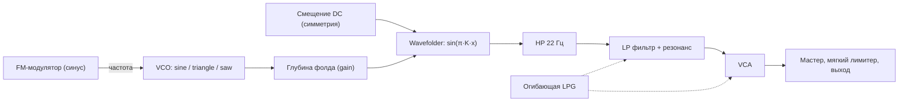

# Складка: описание решения

Мобильный веб-синтезатор: одна страница `index.html`, которую можно установить как приложение (PWA). Одна кнопка: любое нажатие запускает случайный арпеджиатор, который играет, пока палец на экране. Быстрый тап ловит один удар. Звук целиком синтезируется в браузере через Web Audio API, зависимостей нет.

Этот документ описывает, как устроен голос, откуда берутся случайные значения, как работает генератор мелодий и интерфейс, и почему пресеты почти всегда звучат пригодно.

## 1. Идея

Модульный синтезатор в духе Buchla сводится к трём блокам: осциллятор, фолдер волны и low pass gate. Здесь они собраны в один голос и управляются одной кнопкой. Пользователь ничего не настраивает, он только нажимает и слушает. Каждая нажатая нота это новый патч.

Единственное жёсткое правило: октава всегда 1 или 2 (в научной нотации, C1 = 32.7 Гц, B2 = 123.5 Гц). Всё остальное случайно, но только внутри диапазонов, где звук остаётся годным (раздел 4).

## 2. Сигнальная цепь



Голос создаётся заново на каждую ноту и удаляется после затухания. Он монофонический: новая нота за 5 мс гасит предыдущую (отдельный `kill`-gain) и стартует на 12 мс позже, чтобы не было щелчков.

### 2.1. VCO и FM

- Несущая: `OscillatorNode`, форма случайно из sine, triangle, sawtooth.
- Модулятор: синусный `OscillatorNode` на частоте `f · ratio`, через `GainNode` подключён к `osc.frequency`.
- Девиация в герцах равна `index · f · ratio`, поэтому индекс модуляции (`i`) не зависит от высоты ноты: спектр всегда имеет порядка `i + 1` боковых полос с шагом в частоту модулятора.
- Индекс спадает во время ноты: `setTargetAtTime` к значению `index · fmSweep` с постоянной времени `0.7 · tau`.

### 2.2. Wavefolder

Сделан через `WaveShaperNode` с кривой на 4097 точек, `oversample = '4x'`:

```
y = sin(π · K · x),   K = 5,   x ∈ [-1, 1]
```

Входной сигнал `x = depth · osc + sym`, где `depth` задаётся `GainNode` перед шейпером, а `sym` это постоянное смещение (`ConstantSourceNode`), подмешанное прямо на вход шейпера.

- Пик аргумента синуса равен `π·K·depth`: от 0.94 рад при `depth = 0.06` до 12.6 рад при `depth = 0.8`.
- Фолдинг начинается там, где пик достигает π/2, то есть при `depth ≥ 1/(2K) = 0.1`.
- Число перегибов за полупериод примерно `K · depth`, до 4 при максимуме.
- Смещение `sym` до ±0.08 сдвигает фазу фолдинга на ±1.26 рад, что даёт асимметрию и чётные гармоники.
- Выход синусной кривой ограничен ±1 при любой глубине, поэтому громкость почти не зависит от глубины фолда, меняется только спектр.
- Глубина фолда спадает по ходу ноты к `depth · sweep` с постоянной `0.9 · tau`, так что звук начинает ярким и к концу «разглаживается».

После фолдера стоит фильтр высоких частот на 22 Гц (Q = 0.7). Он убирает постоянную составляющую от смещения, иначе при открытии VCA была бы слышна ступенька.

### 2.3. Low pass gate

Один сигнал управляет и громкостью, и срезом, как у вактрола:

| Параметр | Как работает |
|---|---|
| `tau` | `decay / 3`, то есть за `decay` секунд уровень падает примерно до 5 % |
| Атака | линейный подъём VCA от 0 до пика за 1–14 мс |
| Пик VCA | `0.9 · (1 − 0.45 · res / 18) · vel` |
| Срез | экспоненциальный подъём с 70 Гц до `cutoff` за время атаки, затем затухание к 70 Гц с постоянной `0.55 · tau` |
| Конец | `attack + 8·tau`, потом осцилляторы останавливаются, узлы отключаются |

Срез закрывается быстрее, чем падает громкость: хвост ноты становится глуше, как у настоящего LPG.

Фильтр это `BiquadFilterNode` типа lowpass. В Web Audio его `Q` для lowpass задаётся в децибелах, 0 дБ соответствует линейному Q = 1, 18 дБ примерно Q = 8. Пик громкости снижается вместе с резонансом (с 0.9 до 0.495), потому что резонанс добавляет уровень.

### 2.4. LFO за кадром

У каждого патча есть от одного до трёх скрытых LFO. На экране они никак не показываются, их слышно только как медленное или быстрое движение звука.

| Параметр LFO | Диапазон |
|---|---|
| Количество | 1 – 3 (всегда одно, второе с вероятностью 60 %, третье 25 %) |
| Скорость | 0.02 – 8 Гц, логарифмически равномерно: от одного цикла за 50 секунд до шестнадцатой при 120 BPM |
| Форма | sine, triangle, saw, square (синус и треугольник вдвое чаще) |
| Глубина | 0.15 – 1 от максимума цели |
| Начальная фаза | случайная |

Цель выбирается случайно из семи, глубина умножается на максимальный размах:

| Цель | Что модулируется | Размах при глубине 1 |
|---|---|---|
| `pitch` | `detune` несущей и модулятора вместе, так что FM-отношение не меняется | ±35 центов |
| `ratio` | `detune` только модулятора, отношение уезжает | ±600 центов |
| `index` | усиление FM-модулятора | ±0.5 · 4.5 индекса |
| `fold` | глубина фолда | ±0.35 |
| `sym` | смещение на входе фолдера | ±1.5 · 0.08 |
| `cut` | `detune` фильтра | ±2400 центов, две октавы |
| `res` | резонанс | ±6 дБ |

Как это сделано:

- Форма LFO это `PeriodicWave` из 32 гармоник. Начальная фаза задаётся поворотом гармоник (`k·φ`), потому что у `OscillatorNode` нет прямого параметра фазы.
- LFO принадлежит патчу, а не отдельной ноте. Тап создаёт новые LFO и останавливает LFO предыдущего патча. Все ноты зажатой мелодии пользуются одними и теми же LFO, поэтому медленные действительно «плывут» по ходу мелодии, а быстрые дают вибрато и тремоло по ходу ноты.
- Для каждой ноты создаются свои усилители, которые масштабируют LFO в единицы цели и подключают их к параметрам голоса. После ноты они отключаются, чтобы не накапливались узлы.
- У одиночного тапа очень медленное LFO выглядит как случайный статичный сдвиг параметра: за время одной ноты оно почти не движется.

### 2.5. Выход

`master` (0.85) → мягкий лимитер → `destination`.

Лимитер это ещё один `WaveShaperNode`. До 0.8 он линейный, выше скругляет: `sign(x) · (0.8 + 0.2 · tanh((|x| − 0.8) / 0.2))`. Он прозрачен для обычного уровня и ловит только случайные пики, например при перекрытии двух нот в момент передачи.

## 3. Случайные параметры

Функция `roll()` возвращает целый патч. Все значения независимы.

| Параметр | Диапазон | Распределение |
|---|---|---|
| Октава | 1 или 2 | 50/50, единственное жёсткое правило |
| Нота | 12 полутонов | равномерно, MIDI = 12·(oct+1) + semi |
| Форма волны | sine, triangle, sawtooth | равномерно |
| FM ratio | 0.5, 1, 1.5, 2, 2.5, 3, 3.5, 4, 5, 7 | из набора, в 25 % случаев с расстройкой ±2 % |
| FM index | 0 – 4.5 | равномерно |
| FM sweep | 0.05 – 1 | во сколько раз индекс упадёт к концу ноты |
| Глубина фолда | 0.06 – 0.8 | равномерно |
| Симметрия | ±0.08 | равномерно |
| Фолд sweep | 0.2 – 1 | во сколько раз глубина упадёт к концу ноты |
| Затухание | 0.12 – 1.8 с | логарифмически равномерно |
| Атака | 1 – 14 мс | равномерно |
| Срез | 0.9 – 9 кГц | логарифмически равномерно |
| Резонанс | 0 – 18 дБ | равномерно |
| LFO | 1 – 3 штуки, скорость 0.02 – 8 Гц | см. раздел 2.4 |

Логарифмическое распределение там, где важно относительное изменение: на длинном затухании и срезе равномерное распределение почти всегда давало бы длинные и яркие звуки.

## 4. Почему пресеты почти всегда звучат пригодно

Это не чистая случайность, а случайность внутри заранее выбранных рамок:

- LPG связывает громкость и яркость, поэтому любая нота получает естественную форму: щипок, пинг или короткий бас. Беззвучных или статичных вариантов нет.
- Синусный фолдер нормирует уровень, а компенсация резонанса и лимитер держат громкость.
- FM-отношения берутся из набора простых и полупростых отношений, а не из непрерывного диапазона. Это почти всегда консонанс, а небольшая расстройка иногда даёт биения.
- Две низкие октавы дают плотный бас, который прощает почти любую настройку.
- Диапазоны подобраны на слух: нижняя граница глубины и среза не даёт совсем глухих звуков, верхняя граница индекса и резонанса не даёт совсем «шума».

## 5. Генератор мелодий

Запускается сразу при нажатии и играет, пока палец на экране. Если отпустить быстро, успевает прозвучать только первая нота: это всегда настоящая нота (не пауза), и она громкая.

При старте выбираются:

- Темп: целое от 110 до 135 BPM. Шаг это шестнадцатая, длительностью `60 / BPM / 4`, то есть от 0.111 до 0.136 с. Такт из 16 шагов длится от 1.8 до 2.2 с.
- Тоника: случайный из 12 полутонов.
- Лад: из 12, MAJOR, MINOR, DORIAN, PHRYGIAN, LYDIAN, MIXOLYDIAN, HARM MINOR, MIN PENTA, MAJ PENTA, HIRAJOSHI, WHOLE TONE, BLUES.

Пул нот: все ноты лада в диапазоне MIDI 24–47, то есть C1…B2. Поэтому правило об октавах 1 и 2 действует и в мелодии.

Генерация шага (`makeStep`):

- 22 % шагов это пауза.
- В 15 % случаев высота выбирается случайно из всего пула, иначе она сдвигается от предыдущей на ступень из набора −3, −2, −1, −1, 0, 1, 1, 2, 3. Это даёт мелодию, которая в основном идёт плавно, но иногда прыгает.
- Громкость шага: 25 % акценты с `vel = 1`, остальные от 0.62 до 0.85.

Пока нажатие удерживается, ничего не перебрасывается, включая LFO. Каждое нажатие бросает новый патч, лад, тональность, темп и рисунок из 16 шагов (`tapPatch`), и мелодия играет ими по кругу. Меняется только высота и громкость шага, затухание и тембр берутся из патча.

### 5.1. Планировщик

Таймер `setInterval` с периодом 25 мс смотрит на `ctx.currentTime` и ставит в расписание все шаги, которые попадают в окно 120 мс вперёд. Сами ноты планируются средствами Web Audio (`setValueAtTime`, `setTargetAtTime`), поэтому тайминг не зависит от того, насколько точно срабатывает таймер JavaScript.

Обновление экрана привязано к моменту начала ноты (`atTime`), а не к моменту планирования, чтобы кольцо не опережало звук.

Когда нажатие отпускается, ноты, которые уже стоят в расписании, но ещё не начались, отменяются: гейт обнуляется, осцилляторы останавливаются, а их вспышки на экране не показываются. Благодаря этому быстрый тап даёт ровно один удар, каким бы коротким ни был шаг.

## 6. Интерфейс

Один экран: чёрный фон, один янтарный акцент, никаких надписей, чисел и графиков.

- Круглая кнопка почти во всю ширину экрана с символом включения. Вокруг неё кольцо из 60 делений (12 крупных): подсвеченные деления показывают текущий уровень огибающей LPG и гаснут против часовой стрелки.
- Экран целиком это кнопка. Любое нажатие запускает арпеджиатор, он играет, пока палец на экране. Круглая кнопка показывает нажатие: рамка и символ становятся янтарными.
- 16 шагов арпеджиатора это сектора внутри кнопки (кольцо между иконкой и краем). При нажатии они показывают рисунок: паузы пустые, ноты залиты тем сильнее, чем громче. Играющий шаг вспыхивает акцентным цветом и плавно гаснет. При быстром тапе вспыхивает только первый сектор, видно, что поймали один удар. Снаружи кнопки остаётся только кольцо делений огибающей, без точек, поэтому элементы не слипаются.
- Заливка секторов радиальный градиент: у иконки почти прозрачная, к краю плотная. Вспышка играющего шага накладывается отдельным градиентным слоем акцентного цвета и гаснет.
- Фон: два мягких пятна цвета патча. Их положение и яркость ведут скрытые LFO, на каждую четвёртую долю фон коротко вспыхивает. Когда звук стих, он плавно гаснет до чёрного.
- Весь диск слегка «дышит» на каждую четвёртую долю (шаги 0, 4, 8, 12).
- Цвет акцента зависит от патча: sine холодный (около 192°), triangle янтарный (38°), saw горячий (6°), индекс FM сдвигает оттенок до +36°.
- За диском мягкое свечение, яркость которого дрейфует вместе со скрытыми LFO патча (считается в JS по их скорости, форме и фазе).
- Кнопка мягко вспыхивает изнутри на каждую ноту, сильнее на акцентах.
- Нота, лад, темп и значения параметров не показываются. Понять, что играет, можно только по звуку.

Тёмная тема единственная осознанно: страница моделирует прибор.

## 7. Ввод и совместимость

- Нота запускается на `pointerdown`, а не на `click`, чтобы не терять 100–300 мс на мобильных браузерах.
- Слушатели стоят на `body`, поэтому нажатие работает по всему экрану. `setPointerCapture` гарантирует, что отпускание будет доставлено, даже если палец сдвинулся.
- Дополнительно слушаются `pointerup`, `pointercancel`, `lostpointercapture` и `blur`, чтобы мелодия не залипала.
- iOS разблокирует звук только внутри `click` и `touchend`, поэтому на `click` добавлен повторный `resume()` с отложенным запуском первой ноты.
- `navigator.audioSession.type = 'playback'` там, где поддерживается, чтобы звук не глушился переключателем беззвучного режима.
- Пробел и Enter работают как кнопка (нажатие и удержание).
- `ConstantSourceNode` проверяется на наличие, на старых браузерах симметрия просто отключается.

## 8. Ограничения

- Динамик телефона почти не воспроизводит 30–60 Гц. Основной тон низких нот слышен слабо, а звук держится на гармониках от фолдера и FM. В наушниках бас заметно полнее.
- Сид не сохраняется: понравившийся патч повторить нельзя.
- Голос монофонический, нота всегда обрывает предыдущую.
- Мелодия не мутирует и не меняет тембр, пока кнопка зажата (это сделано намеренно).
- На экране нет ни имени ноты, ни лада, ни значений параметров: узнать, что играет, можно только на слух.

## 9. Идеи для развития

- Сохранение понравившегося патча долгим свайпом и список сохранённых.
- Сид в адресе страницы, чтобы делиться патчем ссылкой.
- Режим фиксации: мелодия играет без удержания кнопки.
- Ограничение нот гаммой и в одиночном тапе.
- Привязка FM-индекса и среза к акцентам в мелодии.

## 10. Файлы и публикация

| Файл | Содержимое |
|---|---|
| `index.html` | вся страница: разметка, стили, скрипт |
| `manifest.webmanifest` | манифест PWA: имя, цвета, иконки, режим standalone |
| `sw.js` | service worker: кэш оболочки и работа без сети |
| `icons/` | иконки 192 и 512 пикселей, maskable 512 и `apple-touch-icon` 180 |
| `README.md` | краткое описание |
| `DESIGN.md` | этот документ |

Страница статическая, подойдёт любой хостинг. В `index.html` подключён сниппет Vercel Web Analytics: на Vercel он заработает после включения Analytics в проекте, на других хостингах его скрипт отдаёт 404 и на работу страницы не влияет. Других внешних ресурсов страница не использует, шрифты не подключаются.

## 11. PWA

Страницу можно установить на домашний экран и открывать как приложение, в том числе без сети.

- **Манифест:** `display: standalone`, портретная ориентация, чёрные фон и цвет темы. Все пути относительные (`./`), поэтому приложение работает в подпапке, как на GitHub Pages (`/skladka/`).
- **Иконки:** тот же вид, что у страницы: кольцо из 60 делений, часть подсвечена янтарным, как у закрывающегося гейта, и кнопка со значком включения. Maskable-версия уменьшена, чтобы весь рисунок помещался в безопасный круг (80 % ширины), который остаётся после обрезки на Android.
- **Service worker:** при установке кэширует оболочку (страница, манифест, иконки). Навигация идёт сначала в сеть и обновляет кэш, без сети отдаётся кэшированная страница. Остальные запросы к тому же адресу идут из кэша. Запросы к `/_vercel/` (аналитика) не кэшируются, запросы к другим доменам не перехватываются.
- **Обновления:** новая версия страницы подхватывается при следующем открытии с сетью. Если меняются иконки или манифест, нужно поднять номер в `CACHE` в `sw.js`, чтобы старый кэш был удалён.
- **Установка:** в Chrome и Edge через меню или предложение установить, на iPhone через Safari: «Поделиться» → «На экран Домой». Для установки нужен HTTPS, GitHub Pages его даёт.
- **Звук:** как и в браузере, на iPhone звук включается только после первого касания экрана.
