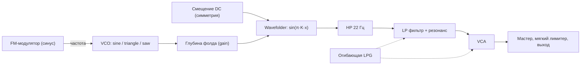

# Складка: описание решения

Мобильный веб-синтезатор: одна страница `index.html`, которую можно установить как приложение (PWA). Одна кнопка: любое нажатие запускает случайный арпеджиатор, который играет, пока палец на экране. Быстрый тап ловит один удар. Звук целиком синтезируется в браузере через Web Audio API, зависимостей нет.

Этот документ описывает, как устроен голос, откуда берутся случайные значения, как работает генератор мелодий и интерфейс, и почему пресеты почти всегда звучат пригодно.

## 1. Идея

Модульный синтезатор в духе Buchla сводится к трём блокам: осциллятор, фолдер волны и low pass gate. Здесь они собраны в один голос и управляются одной кнопкой. Пользователь ничего не настраивает, он только нажимает и слушает. Каждая нажатая нота это новый патч.

Единственное жёсткое правило: октава всегда 1 или 2 (в научной нотации, C1 = 32.7 Гц, B2 = 123.5 Гц). Всё остальное случайно, но только внутри диапазонов, где звук остаётся годным (раздел 4).

## 2. Сигнальная цепь



Голос создаётся заново на каждую ноту и удаляется после затухания. Он монофонический: новая нота за 5 мс гасит предыдущую (отдельный `kill`-gain) и стартует на 12 мс позже, чтобы не было щелчков.

### 2.1. VCO и FM

- Несущая: `OscillatorNode`, форма случайно из sine, triangle, sawtooth.
- Модулятор: синусный `OscillatorNode` на частоте `f · ratio`, через `GainNode` подключён к `osc.frequency`.
- Девиация в герцах равна `index · f · ratio`, поэтому индекс модуляции (`i`) не зависит от высоты ноты: спектр всегда имеет порядка `i + 1` боковых полос с шагом в частоту модулятора.
- Индекс спадает во время ноты: `setTargetAtTime` к значению `index · fmSweep` с постоянной времени `0.7 · tau`.

### 2.2. Wavefolder

Сделан через `WaveShaperNode` с кривой на 4097 точек, `oversample = '4x'`:

```
y = sin(π · K · x),   K = 5,   x ∈ [-1, 1]
```

Входной сигнал `x = depth · osc + sym`, где `depth` задаётся `GainNode` перед шейпером, а `sym` это постоянное смещение (`ConstantSourceNode`), подмешанное прямо на вход шейпера.

- Пик аргумента синуса равен `π·K·depth`: от 0.94 рад при `depth = 0.06` до 12.6 рад при `depth = 0.8`.
- Фолдинг начинается там, где пик достигает π/2, то есть при `depth ≥ 1/(2K) = 0.1`.
- Число перегибов за полупериод примерно `K · depth`, до 4 при максимуме.
- Смещение `sym` до ±0.08 сдвигает фазу фолдинга на ±1.26 рад, что даёт асимметрию и чётные гармоники.
- Выход синусной кривой ограничен ±1 при любой глубине, поэтому громкость почти не зависит от глубины фолда, меняется только спектр.
- Глубина фолда спадает по ходу ноты к `depth · sweep` с постоянной `0.9 · tau`, так что звук начинает ярким и к концу «разглаживается».

После фолдера стоит фильтр высоких частот на 22 Гц (Q = 0.7). Он убирает постоянную составляющую от смещения, иначе при открытии VCA была бы слышна ступенька.

### 2.3. Low pass gate

Один сигнал управляет и громкостью, и срезом, как у вактрола:

| Параметр | Как работает |
|---|---|
| `tau` | `decay / 3`, то есть за `decay` секунд уровень падает примерно до 5 % |
| Атака | линейный подъём VCA от 0 до пика за 1–14 мс |
| Пик VCA | `0.9 · (1 − 0.45 · res / 18) · vel` |
| Срез | экспоненциальный подъём с 70 Гц до `cutoff` за время атаки, затем затухание к 70 Гц с постоянной `0.55 · tau` |
| Конец | `attack + 8·tau`, потом осцилляторы останавливаются, узлы отключаются |

Срез закрывается быстрее, чем падает громкость: хвост ноты становится глуше, как у настоящего LPG.

Фильтр это `BiquadFilterNode` типа lowpass. В Web Audio его `Q` для lowpass задаётся в децибелах, 0 дБ соответствует линейному Q = 1, 18 дБ примерно Q = 8. Пик громкости снижается вместе с резонансом (с 0.9 до 0.495), потому что резонанс добавляет уровень.

### 2.4. LFO за кадром

Половина патчей вообще без LFO, у остальных одно скрытое LFO, изредка два. LFO мягкие: они двигают звук, но не должны его портить. На экране они не показываются, только слегка ведут фон.

| Параметр LFO | Диапазон |
|---|---|
| Количество | 0 (50 % патчей), иначе 1, второе с вероятностью 20 % |
| Скорость | 0.02 – 3 Гц, логарифмически равномерно: от одного цикла за 50 секунд до плавного покачивания, без тремоло |
| Форма | sine (в три раза чаще) или triangle, без резких saw и square |
| Глубина | 0.15 – 0.6 от максимума цели |
| Начальная фаза | случайная |

Цель выбирается случайно из семи, глубина умножается на максимальный размах:

| Цель | Что модулируется | Размах при глубине 1 |
|---|---|---|
| `pitch` | `detune` несущей и модулятора вместе, так что FM-отношение не меняется | ±14 центов |
| `ratio` | `detune` только модулятора, отношение уезжает | ±120 центов |
| `index` | усиление FM-модулятора | ±0.25 · 4.5 индекса |
| `fold` | глубина фолда | ±0.18 |
| `sym` | смещение на входе фолдера | ±0.8 · 0.08 |
| `cut` | `detune` фильтра | ±1100 центов, около октавы |
| `res` | резонанс | ±3 дБ |

Как это сделано:

- Форма LFO это `PeriodicWave` из 32 гармоник. Начальная фаза задаётся поворотом гармоник (`k·φ`), потому что у `OscillatorNode` нет прямого параметра фазы.
- LFO принадлежит патчу, а не отдельной ноте. Тап создаёт новые LFO и останавливает LFO предыдущего патча. Все ноты зажатой мелодии пользуются одними и теми же LFO, поэтому медленные действительно «плывут» по ходу мелодии, а быстрые дают вибрато и тремоло по ходу ноты.
- Для каждой ноты создаются свои усилители, которые масштабируют LFO в единицы цели и подключают их к параметрам голоса. После ноты они отключаются, чтобы не накапливались узлы.
- У одиночного тапа очень медленное LFO выглядит как случайный статичный сдвиг параметра: за время одной ноты оно почти не движется.

### 2.5. Выход

`master` (0.85) → мягкий лимитер → `destination`.

Лимитер это ещё один `WaveShaperNode`. До 0.8 он линейный, выше скругляет: `sign(x) · (0.8 + 0.2 · tanh((|x| − 0.8) / 0.2))`. Он прозрачен для обычного уровня и ловит только случайные пики, например при перекрытии двух нот в момент передачи.

## 3. Случайные параметры

Функция `roll()` возвращает целый патч. Все значения независимы.

| Параметр | Диапазон | Распределение |
|---|---|---|
| Октава | 1 или 2 | 50/50, единственное жёсткое правило |
| Нота | 12 полутонов | равномерно, MIDI = 12·(oct+1) + semi |
| Форма волны | sine, triangle, sawtooth | равномерно |
| FM ratio | 0.5, 1, 1.5, 2, 2.5, 3, 3.5, 4, 5, 7 | из набора, в 25 % случаев с расстройкой ±2 % |
| FM index | 0 – 4.5 | равномерно |
| FM sweep | 0.05 – 1 | во сколько раз индекс упадёт к концу ноты |
| Глубина фолда | 0.06 – 0.8 | равномерно |
| Симметрия | ±0.08 | равномерно |
| Фолд sweep | 0.2 – 1 | во сколько раз глубина упадёт к концу ноты |
| Затухание | 0.12 – 1.8 с | логарифмически равномерно |
| Атака | 1 – 14 мс | равномерно |
| Срез | 0.9 – 9 кГц | логарифмически равномерно |
| Резонанс | 0 – 18 дБ | равномерно |
| LFO | 0 – 2 штуки (у половины патчей нет), скорость 0.02 – 3 Гц | см. раздел 2.4 |

Логарифмическое распределение там, где важно относительное изменение: на длинном затухании и срезе равномерное распределение почти всегда давало бы длинные и яркие звуки.

## 4. Почему пресеты почти всегда звучат пригодно

Это не чистая случайность, а случайность внутри заранее выбранных рамок:

- LPG связывает громкость и яркость, поэтому любая нота получает естественную форму: щипок, пинг или короткий бас. Беззвучных или статичных вариантов нет.
- Синусный фолдер нормирует уровень, а компенсация резонанса и лимитер держат громкость.
- FM-отношения берутся из набора простых и полупростых отношений, а не из непрерывного диапазона. Это почти всегда консонанс, а небольшая расстройка иногда даёт биения.
- Две низкие октавы дают плотный бас, который прощает почти любую настройку.
- Диапазоны подобраны на слух: нижняя граница глубины и среза не даёт совсем глухих звуков, верхняя граница индекса и резонанса не даёт совсем «шума».

## 5. Генератор мелодий

Запускается сразу при нажатии и играет, пока палец на экране. Если отпустить быстро, успевает прозвучать только первая нота: это всегда настоящая нота (не пауза), и она громкая.

При старте выбираются:

- Темп: целое от 110 до 135 BPM. Шаг это шестнадцатая, длительностью `60 / BPM / 4`, то есть от 0.111 до 0.136 с. Такт из 16 шагов длится от 1.8 до 2.2 с.
- Тоника: случайный из 12 полутонов.
- Лад: из 12, MAJOR, MINOR, DORIAN, PHRYGIAN, LYDIAN, MIXOLYDIAN, HARM MINOR, MIN PENTA, MAJ PENTA, HIRAJOSHI, WHOLE TONE, BLUES.

Пул нот: все ноты лада в диапазоне MIDI 24–47, то есть C1…B2. Поэтому правило об октавах 1 и 2 действует и в мелодии.

Генерация шага (`makeStep`):

- 22 % шагов это пауза.
- В 15 % случаев высота выбирается случайно из всего пула, иначе она сдвигается от предыдущей на ступень из набора −3, −2, −1, −1, 0, 1, 1, 2, 3. Это даёт мелодию, которая в основном идёт плавно, но иногда прыгает.
- Громкость шага: 25 % акценты с `vel = 1`, остальные от 0.62 до 0.85.

Пока нажатие удерживается, ничего не перебрасывается, включая LFO. Каждое нажатие бросает новый патч, лад, тональность, темп и рисунок из 16 шагов (`tapPatch`), и мелодия играет ими по кругу. Меняется только высота и громкость шага, затухание и тембр берутся из патча.

### 5.1. Планировщик

Таймер `setInterval` с периодом 25 мс смотрит на `ctx.currentTime` и ставит в расписание все шаги, которые попадают в окно 120 мс вперёд. Сами ноты планируются средствами Web Audio (`setValueAtTime`, `setTargetAtTime`), поэтому тайминг не зависит от того, насколько точно срабатывает таймер JavaScript.

Обновление экрана привязано к моменту начала ноты (`atTime`), а не к моменту планирования, чтобы кольцо не опережало звук.

Когда нажатие отпускается, ноты, которые уже стоят в расписании, но ещё не начались, отменяются: гейт обнуляется, осцилляторы останавливаются, а их вспышки на экране не показываются. Благодаря этому быстрый тап даёт ровно один удар, каким бы коротким ни был шаг.

## 6. Интерфейс

Один экран: чёрный фон, один янтарный акцент, никаких надписей, чисел и графиков.

- Круглая кнопка почти во всю ширину экрана с символом включения. Вокруг неё кольцо из 60 делений (12 крупных): подсвеченные деления показывают текущий уровень огибающей LPG и гаснут против часовой стрелки.
- Экран целиком это кнопка. Любое нажатие запускает арпеджиатор, он играет, пока палец на экране. Круглая кнопка показывает нажатие: рамка и символ становятся янтарными.
- 16 шагов арпеджиатора это сектора внутри кнопки (кольцо между иконкой и краем). При нажатии они показывают рисунок: паузы пустые, ноты залиты тем сильнее, чем громче. Играющий шаг вспыхивает акцентным цветом и плавно гаснет. При быстром тапе вспыхивает только первый сектор, видно, что поймали один удар. Снаружи кнопки остаётся только кольцо делений огибающей, без точек, поэтому элементы не слипаются.
- Сектора залиты плоским цветом, без градиента: плотность заливки зависит от громкости ноты, вспышка играющего шага плоская акцентная и плавно гаснет.
- Фон: два мягких пятна цвета патча. Их положение и яркость ведут скрытые LFO, на каждую четвёртую долю фон коротко вспыхивает. Когда звук стих, он плавно гаснет до чёрного.
- Весь диск слегка «дышит» на каждую четвёртую долю (шаги 0, 4, 8, 12).
- Цвет акцента зависит от патча: sine холодный (около 192°), triangle янтарный (38°), saw горячий (6°), индекс FM сдвигает оттенок до +36°.
- За диском мягкое свечение, яркость которого дрейфует вместе со скрытыми LFO патча (считается в JS по их скорости, форме и фазе).
- Кнопка мягко вспыхивает изнутри на каждую ноту, сильнее на акцентах.
- Нота, лад, темп и значения параметров не показываются. Понять, что играет, можно только по звуку.

Тёмная тема единственная осознанно: страница моделирует прибор.

## 7. Ввод и совместимость

- Нота запускается на `pointerdown`, а не на `click`, чтобы не терять 100–300 мс на мобильных браузерах.
- Слушатели стоят на `body`, поэтому нажатие работает по всему экрану. `setPointerCapture` гарантирует, что отпускание будет доставлено, даже если палец сдвинулся.
- Дополнительно слушаются `pointerup`, `pointercancel`, `lostpointercapture` и `blur`, чтобы мелодия не залипала.
- iOS разблокирует звук только внутри `click` и `touchend`, поэтому на `click` добавлен повторный `resume()` с отложенным запуском первой ноты.
- `navigator.audioSession.type = 'playback'` там, где поддерживается, чтобы звук не глушился переключателем беззвучного режима.
- Пробел и Enter работают как кнопка (нажатие и удержание).
- `ConstantSourceNode` проверяется на наличие, на старых браузерах симметрия просто отключается.

## 8. Ограничения

- Динамик телефона почти не воспроизводит 30–60 Гц. Основной тон низких нот слышен слабо, а звук держится на гармониках от фолдера и FM. В наушниках бас заметно полнее.
- Сид не сохраняется: понравившийся патч повторить нельзя.
- Голос монофонический, нота всегда обрывает предыдущую.
- Мелодия не мутирует и не меняет тембр, пока кнопка зажата (это сделано намеренно).
- На экране нет ни имени ноты, ни лада, ни значений параметров: узнать, что играет, можно только на слух.

## 9. Идеи для развития

- Сохранение понравившегося патча долгим свайпом и список сохранённых.
- Сид в адресе страницы, чтобы делиться патчем ссылкой.
- Режим фиксации: мелодия играет без удержания кнопки.
- Ограничение нот гаммой и в одиночном тапе.
- Привязка FM-индекса и среза к акцентам в мелодии.

## 10. Файлы и публикация

| Файл | Содержимое |
|---|---|
| `index.html` | вся страница: разметка, стили, скрипт |
| `manifest.webmanifest` | манифест PWA: имя, цвета, иконки, режим standalone |
| `sw.js` | service worker: кэш оболочки и работа без сети |
| `icons/` | иконки 192 и 512 пикселей, maskable 512 и `apple-touch-icon` 180 |
| `README.md` | краткое описание |
| `DESIGN.md` | этот документ |

Страница статическая, подойдёт любой хостинг. В `index.html` подключён сниппет Vercel Web Analytics: на Vercel он заработает после включения Analytics в проекте, на других хостингах его скрипт отдаёт 404 и на работу страницы не влияет. Других внешних ресурсов страница не использует, шрифты не подключаются.

## 11. PWA

Страницу можно установить на домашний экран и открывать как приложение, в том числе без сети.

- **Манифест:** `display: standalone`, портретная ориентация, чёрные фон и цвет темы. Все пути относительные (`./`), поэтому приложение работает в подпапке, как на GitHub Pages (`/skladka/`).
- **Иконки:** тот же вид, что у страницы: кольцо из 60 делений, часть подсвечена янтарным, как у закрывающегося гейта, и кнопка со значком включения. Maskable-версия уменьшена, чтобы весь рисунок помещался в безопасный круг (80 % ширины), который остаётся после обрезки на Android.
- **Service worker:** при установке кэширует оболочку (страница, манифест, иконки). Навигация идёт сначала в сеть и обновляет кэш, без сети отдаётся кэшированная страница. Остальные запросы к тому же адресу идут из кэша. Запросы к `/_vercel/` (аналитика) не кэшируются, запросы к другим доменам не перехватываются.
- **Обновления:** новая версия страницы подхватывается при следующем открытии с сетью. Если меняются иконки или манифест, нужно поднять номер в `CACHE` в `sw.js`, чтобы старый кэш был удалён.
- **Установка:** в Chrome и Edge через меню или предложение установить, на iPhone через Safari: «Поделиться» → «На экран Домой». Для установки нужен HTTPS, GitHub Pages его даёт.
- **Звук:** как и в браузере, на iPhone звук включается только после первого касания экрана.

Для фона у каждого патча есть тихий двойник LFO: он ничего не слышно меняет и ведёт только свечение, когда у патча нет звукового LFO.

## Скины

При каждом запуске случайно выбирается один из семи тёмных внешних видов (amber, riso, scope, topo, matrix, mandala, ridges) (`html[data-skin]`, выбор делает маленький скрипт в `<head>` до первой отрисовки). Звук, арпеджиатор и логика у всех одинаковые, меняется только оформление. Для проверки можно принудительно задать вид адресом `?skin=amber|riso|scope|topo|matrix|mandala|ridges`. Светлые скины paper и donut убраны из ротации по решению автора (слишком светлые), их код остаётся в файле и открывается по `?skin=paper` или `?skin=donut`, но свайпом до них не добраться. При желании их можно перекрасить в тёмные.

**Переключение свайпом.** Стартовый скин выбирается случайно (случайный индекс в списке из семи), дальше его можно менять горизонтальным свайпом: влево следующий, вправо предыдущий, по кругу. Свайпом считается смещение больше 56 пикселей, заметно горизонтальное (в 1.5 раза больше вертикального). В момент свайпа арпеджиатор останавливается (если успел стартовать, прозвучит максимум одна нота), старый слой стирается, строится новый, текущий рисунок шагов и цвет переносятся. Обычный тап скин не меняет. Анимация двухфазная: пока палец тянется, сцена едет за ним и тускнеет, внизу появляются точки-индикатор (текущий вид это вытянутая светлая точка); при пересечении порога старая сцена уезжает в сторону свайпа за 0.17 с, затем новая влетает с противоположной стороны за 0.32 с, точки остаются на секунду. Повторный свайп во время смены игнорируется.

Страница обрезает выступающие за экран свечения (`overflow: hidden` на `html, body`), иначе мобильный браузер расширял layout viewport (453×981 вместо 390×844), и фиксированные слои сдвигались.

**Сквозное правило: цвет и оттенок меняются при каждом нажатии у всех скинов.** Патч задаёт переменную `--hue` (sine холодный около 192°, triangle около 38°, saw около 6°, индекс FM добавляет до 36°). Каждый скин строит свою палитру из `--hue` со своим смещением, поэтому при значении по умолчанию (38) выглядит так, как задумано, а после нажатия палитра уезжает. Пока палец держится, цвет не меняется.

- **amber**: чёрный и янтарный, основной вид. Акцент это `hsl(--hue …)`.
- **riso**: тёмная бумага, ризографические чернила. Розовый круг (оттенок `--hue + 302`) смешивается через `screen` с полутоновым кругом партнёрского оттенка (+140°) со сдвигом, как при неточной приводке. Кнопка цвета бумаги, шаги залиты основным чернилом, играющий шаг тёмный. Сверху зерно.
- **scope**: осциллограф, сетка, сканлайны, виньетка. Фосфор от зелёного к бирюзовому и синему (`--hue · 0.5 + 100`). Ринг это трасса, форма которой считается из патча (отношение FM, индекс FM, глубина фолда).
- **topo**: рельеф. Топографические контуры на тёмном тоне оттенка (`--hue + 38`), кнопка-вершина, шаги это 16 дуг на одной из горизонталей. Контуры медленно вращаются в разные стороны.
- **matrix**: матрица точек. Размер точек расходится волной от кнопки, оттенок `--hue − 23`, кнопка кремовая, шаги это кольцо крупных точек.
- **paper**: слои цветной бумаги с тенями, оттенки раскладываются вокруг `--hue − 34`. Шаги это 16 выступов волнистого слоя: чем громче нота, тем больше выступ.
- **donut**: хрустящий глазированный донат. Рваный край теста (`feDisplacementMap`), глазурь оттенка `--hue + 302`, посыпка это шаги, в дырке кнопка.

Скины riso, scope и amber переопределяют цвета и слои CSS-селекторами `html[data-skin=…]`. Скины topo, matrix, mandala, ridges, paper и donut рисуют собственную картинку в полноэкранном SVG-слое `#skin` (координаты с центром в середине экрана, `viewBox="-195 -422 390 844"`) и подключаются через хуки: `pattern(sq)` (рисунок шагов), `note(i, vel)` (вспышка), `frame(t, env, kick, head)` (покадровая анимация), `idle()` (сброс в покой).

### Анимация скинов

Покадровый цикл `fxFrame` работает, только пока что-то движется (играет арп, идёт огибающая или не затух «удар»), потом останавливается сам. Каждая нота даёт удар `kick`, который затухает за ~0.2 с.

- **scope**: трасса пересчитывается каждый кадр. Она плывёт во времени, дышит с огибающей, толстеет и светится на ударе, а по кольцу с темпом секвенсора бежит горб (положение берётся из часов арпеджиатора, поэтому он идёт и по паузам). Фоном ходит яркая полоса развёртки и слегка мерцает экран.
- **riso**: вокруг розового круга 16 чернильных точек (розовые и синие по очереди, размер от громкости, паузы бледные). Играющая точка вспыхивает цветом бумаги и подпрыгивает. На каждой ноте синий полутоновый круг дёргается в случайную сторону, как сбитая приводка, и пружинит назад. Розовый круг дышит с огибающей, размер полутоновых точек растёт с громкостью, зерно мерцает.

- **topo**: сами кривые живые. Каждое кольцо пересчитывается каждый кадр из медленно плывущих фаз, поэтому вся карта течёт. В покое кадры идут примерно 24 в секунду, при игре на полной частоте. Музыка ускоряет течение (время растёт быстрее с огибающей и ударом) и раздувает рельеф (амплитуда до +50% от огибающей и +60% от удара). 16 дуг шагов едут по одному из колец и повторяют его форму. Играющая дуга вспыхивает контрастным цветом и утолщается. Поверх контуры медленно вращаются в разные стороны. При смене скина цикл останавливается (`SK.dispose`), при `prefers-reduced-motion` рисуется один кадр.
- **matrix**: волна точек бежит наружу от кнопки, её сила растёт с огибающей и ударом. Играющая точка кольца вспыхивает и подпрыгивает.
- **paper**: слои бумаги расходятся с разной амплитудой, играющий выступ подпрыгивает цветом бумаги.
- **donut**: играющая посыпка вспыхивает белым и подпрыгивает, глазурь чуть вздувается на ударе, сахарные искры мерцают.

### Мандала (mandala)
16 лепестков, по одному на шаг. Длина и ширина зависят от громкости ноты, паузы это маленькие бутоны. На ноте лепесток вспыхивает и на 150 мс «выстреливает». Между ними 16 малых лепестков, которые медленно вращаются в обратную сторону, и пунктирные кольца. Кик слегка раздувает все слои. Цвет берётся из `--hue`.

**Звук мандалы: дэб-техно аккорды.** Единственный скин со своим звуком (включается, если при нажатии выбран скин mandala). Образец: мир Portus в репо touch2decay (стабы Basic Channel).
- **Лад:** только минорные: minor, dorian, phrygian, harmonic minor, minor pentatonic.
- **Аккорд:** одна огласовка на нажатие, интервалы от основы как в Portus: m7 `[0,7,10,15]`, m9 `[0,7,10,14,15]` (оба вдвое чаще), m11 `[0,7,10,14,15,17]`, sus `[0,5,10,14]`. Основа чаще всего тоника (65%), иногда скользит на другую ступень лада. Основы лежат в одной октаве (1 или 2), аккорд строится вверх от них.
- **Голос:** на каждый тон пара пил с расстройкой ±5–8 центов, два фильтра 24 дБ подряд, щипок: срез раскрывается на `cut*2^(env*4.2*vel)` и падает к `cut`, длина щипка `tau = 0.035 + len²·1.8`. Лёгкая случайная панорама на каждый удар. 45% пауз.
- **Рандом на нажатие:** тип аккорда и лад, срез, глубина щипка, резонанс (0–15 дБ), длина, медленный дрейф среза, время эха (1/8, 3/16, 1/4, 3/8, 1/2), фидбэк, количество эха (иногда 0), тон эха, ping-pong по каналам, длина реверберации (1,2–4,5 с) и её количество.
- **LFO:** всегда один медленный на срез фильтра (0,04–0,4 Гц, 0–900 центов). Плюс в 60% нажатий один или два дополнительных (0,03–0,5 Гц, синус или треугольник) на резонанс, фидбэк эха, количество эха, количество реверба или wow времени эха. Защита от перегруза: глубина каждого ограничена долей базового значения (ничего не уходит в минус), фидбэк не поднимается выше 0,86, в петле эха стоит мягкий tanh-насытитель, резонанс уменьшает уровень аккорда, на выходе общий мягкий лимитер.
- Хвосты звучат после отпускания, старая шина гасится через ~3 с после следующего нажатия. Тап ловит один аккорд.

### Хребты (ridges)
Кислотная раскраска: один горизонтальный градиент красит все линии, у каждого из 16 шагов своя точка с собственным оттенком (оттенки идут по кругу с шагом 1,5 круга), весь круг медленно дрейфует по оттенку (быстрее при громкой игре), точка сыгранного шага на мгновение вспыхивает почти белым и гаснет за ~0,5 с. Точки шагов внизу красятся теми же цветами. Паузы тусклые.
Стопка из 36 линий рельефа с перекрытием (как обложка Unknown Pleasures). Каждая нота пускает горб от x-позиции своего шага вверх по стопке, горб расширяется и затухает. Фоновая рябь растёт с огибающей. Внизу ряд из 16 точек-шагов. Свой rAF-цикл (в покое ~24 fps), останавливается через `SK.dispose`.


## Звук скинов (не янтарь)
У каждого скина, кроме янтаря (базовый FM + фолдер + LPG), свой голос и своя шина эха и реверба со своими диапазонами случайности (общий ping-pong, реверб из шумового импульса, LFO на шине, мягкий насытитель в петле эха). Октавы нот остаются 1–2, паттерн, лад и тембр не меняются, пока держишь, тап ловит один удар.
- **Мандала:** дэб-техно аккорды (см. выше).
- **Ризо:** банк резонаторов (полосовые фильтры с высокой добротностью, три гармоники на тон), настроенных на мажорный или минорный аккорд (трезвучие или септаккорд по ступени лада: MAJOR, MINOR, DORIAN, MIXOLYDIAN), возбуждается всплеском шума. Добротность растёт с частотой, поэтому низкие тона звенят дольше. После резонаторов лёгкое огрубление по битности.
- **Осциллограф:** лазеры по ударным Horologium из ветки native репо touch2decay (`core/worlds/horologium/drums.cpp`). Три режима на нажатие: ZAP (синус или пила падает с нескольких кГц на ноту через tanh), STUTTER (3–8 коротких FM-гранов, питч растёт, промежутки сжимаются ×0,7), BIT (1-битный шум выше 6 кГц). Акценты и часть ударов добавляют «пинг» (всплеск шума в узкий резонатор 1,5–6 кГц). Перед выходом фильтр высоких (140–1000 Гц), чтобы низкие ноты не звучали глухо, короткий ping-pong эхо.
- **Рельеф:** не секвенция, а эволюционирующий дрон, пока держишь. Две пульсовые волны (пила через ступенчатый waveshaper и постоянное смещение, смещение качает свой медленный LFO, так получается PWM) с расстройкой и квинта, два фильтра 24 дБ с резонансом (до 14 дБ), срез дрейфует двумя несинхронными LFO (0,03–0,12 и 0,1–0,35 Гц). Большой реверб. Шаги на экране идут, но звука не издают. Тап даёт короткий взмах.
- **Матрица:** чиптюновые блипы с четырьмя субшагами (арпеджио октав и квинт внутри шага), огрубление по битности, ступенчатый полосовой фильтр.
- **Хребты:** ацид в духе TB-303. Один осциллятор (пила или квадрат на нажатие), перегруз, два фильтра подряд с резонансом до 20 дБ, огибающая среза с распадом (случайная глубина и время), акценты (громче, глубже и короче огибающая), слайды между связанными нотами (гейт не закрывается, питч едет за 60 мс), прыжки на октаву, лады minor/phrygian/harmonic minor/minor pentatonic/blues/dorian, 28% пауз. Эхо с мягким ревербом.
Проверено автоматически в хромиуме (ошибок нет, сигнал и затухание есть), на слух и на телефоне не проверялось.

## Эволюционирующие скины без секвенсера
Рельеф играет непрерывный дрон, шаги не звучат и не светятся. Картинку ведёт модуляция звука: огибающая яркости следует двум LFO среза (0,5 + 0,28·LFO_A + 0,22·LFO_B), по кругу из 16 дуг бежит яркое пятно с фазой быстрого LFO, раз в цикл быстрого LFO вспышка (kick и свечение кнопки). Реализовано хуком `cont.mod()` голоса и таймером 33 мс (`startMod`). Туннель «приближение» с восходящим шепардом удалён по решению автора («не могу найти концепцию»).

## Синестезия: палитра и темп читают звук
Каждое нажатие после создания патча и паттерна считает три числа (`characterOf`, 0…1), и по ним красится весь экран (`setAccent`, `applyMood`):
- **Яркость звука** (срез фильтра внутри диапазона голоса этого скина и глубина огибающей) → светлота экрана: CSS-фильтр `brightness(0,8…1,18)` на `html`.
- **Живость** (резонанс, глубина огибающей, доля играющих шагов, темп, короткие ноты) → насыщенность (`saturate(0,6…1,25)`) и темп движения: переменная `--act` (0,6…1,6) и множитель `ACT` в покадровой анимации рельефа и хребтов, длительность вращения мандалы `calc(90s / var(--act))`.
- **Холод** (яркость, пространство эха и реверба, резонанс, FM) → оттенок `--hue` от тёплого янтаря 28° через розовый и фиолетовый до холодного синего (218°). Остальные цвета скинов строятся от `--hue` со своими смещениями, как раньше.
Яркость считается внутри диапазона голоса скина, поэтому у каждого скина встречаются и тёплые, и холодные, тёмные и светлые, спокойные и активные нажатия.

## Без кнопки и XY
Кнопка и кольцо секвенсера остаются в янтаре, мандале и ризо («пока»). В осциллографе, рельефе, матрице и хребтах их нет (`display: none`), экран целиком это поверхность. Геометрия экранов прежняя, но волны и эффекты идут не из центра, а от пальца: координаты пальца в единицах слоя скина лежат в `FP` (`vx, vy`, центр экрана это 0, 0). Осциллограф: поле «Жизни» Конвея (26×56 клеток на торе), каждая нота пускает в точке пальца глайдер (громкая) или блинкер (тихая) и сдвигает поколение, в тишине поле медленно дрейфует, вымершее пересеивается, переполненное прореживается; возраст клетки задаёт размер и яркость. Рельеф: контуры (36 колец, от маленького ядра в центре, дыры в середине нет) мягко расталкиваются от пальца, от него на каждый бит LFO и при касании уходит круг-рябь. Матрица: кольца яркости `cos(d/24 − t·2.4)` идут от пальца, поверх них две медленные интерференционные волны, поэтому переливается всё поле и тёмных зон нет (собственный rAF, как у рельефа). Хребты: каждая нота пускает бугор из точки пальца вверх и вниз по стопке, ряд точек шагов убран. Хребты расширены до ±330 по x.
**Задел под xy-pad:** состояние `window.skladka.xy = { x, y (0…1, y вниз), nx, ny (-1…1 от центра, ny вверх), down }`, событие `skladka:xy` (detail = то же) и хук скина `SK.xy(xy)`. Звук к координатам пока не привязан.
**Свайп** теперь только быстрый флик: больше 56 пикселей по горизонтали за первые 300 мс. Более медленное движение двигает мир (xy).

## Без кнопки везде (2026-11-06)
Кнопки и кольца секвенсера нет ни в одном скине. Круг под палец не двигаем: «явный и чёткий круг» не смещаем.
**Янтарь: ночная трасса** (`buildAmber`). Неоновая сетка-дорога уходит к полосатому солнцу за силуэтом города, цвет от `--hue` (янтарный по умолчанию). Дорога едет всегда, скорость растёт с огибающей и кик; каждая нота пускает по дороге яркую поперечную планку; пока палец держится, точка схода тянется к пальцу (дорога изгибается), высота горизонта слегка следует по y.
**Ризо:** плоские цветные круги разного размера (заливка и контур, `mix-blend-mode: screen`, зерно остаётся) дрейфуют по экрану; нота даёт в точке пальца кремовую вспышку круга, ближайший круг подпрыгивает, кик раздувает все.
**Мандала:** цветок вернулся, но без кнопки и кольца шагов и без привязки к секвенсеру: пять слоёв лепестков (12, 16, 20, 24, 28), чем глубже, тем крупнее и медленнее вращается, растут на весь экран. «Расцветает»: слои раскрываются по очереди из середины, пока играет, и наполовину закрываются в тишине. Параллакс: слои смещаются от пальца с разной глубиной. Положение пальца играет радиальный градиент-свечение, которое плавно идёт за ним и растёт с огибающей.

## Палец как XY-пад: у каждого скина свои два параметра (2026-11-06)
Каждое нажатие по-прежнему вытягивает новый патч, а палец гнёт его вживую, пока держишь: значения относительны (множители и смещения от того, что выпало), поэтому характер патча сохраняется. Нажатие стартует там, где палец; медленное движение двигает параметры, быстрый флик по горизонтали меняет скин.
| скин | X (слева направо) | Y (снизу вверх) |
|---|---|---|
| янтарь | яркость (срез, ±1,4 октавы) | гармоники (индекс FM и глубина фолда) |
| мандала | эхо: количество и фидбэк | срез фильтра (±1,6 октавы) и резонанс (дабовая пара) |
| ризо | яркость аккорда | длина звона резонаторов и реверб |
| осциллограф | высота лазера (свип, зёрна) | эхо: количество и фидбэк |
| рельеф | срез дрона (живьём) | размах ШИМ (ширина импульса дрона, живьём) и реверб |
| матрица | глубина кранча (биты) | фокус фильтра (резонанс) |
| хребты | срез (ацид) | резонанс (ацид, живьём) |
Реализация: `applyXY(nx, ny)`; в шине эха хранятся базовые значения (`bus.base`) и глубины модуляторов, поэтому при смене эха и фидбэка их собственные LFO пересчитываются, и фидбэк вместе с покачиванием не превышает 0,86. Для амбера глобальные множители `XM`, которые читает `play()`. Для проверок: `window.skladka.sound()` возвращает текущие значения шины.

### Экран отвечает на оси (2026-11-06, перечень утверждён)
Тот же палец двигает и картинку, и звук. Сглаженное положение пальца `XV` (x, y от 0 до 1, y вверх) читают все скины.
| скин | X | Y |
|---|---|---|
| янтарь | свечение неона и дороги | размах полос на солнце |
| мандала | сколько колец-эха идёт за нотой | яркость лепестков и скорость вращения |
| ризо | насыщенность печати кругов | как долго звенит вспышка круга |
| осциллограф | цвет клеток (от холодного к горячему) | сколько копий глайдера идёт за нотой (эхо) |
| рельеф | чёткость линий (тоньше и ярче вправо) | рельеф набухает и опадает вместе с ШИМ, рябь бежит дальше и чаще |
| матрица | грубость картинки (число уровней яркости от 2 до 5) | резкость колец и яркость |
| хребты | яркость линий | высота и острота горбов |
Мандала стала живее: у каждого лепестка своя качка и дыхание, слои вращаются со скоростью музыки, нота запускает волну набухания от центра наружу.

## Переход между мирами: параметры связаны, модуляции переходят (2026-11-06)
Оси XY управляют не ручками одного мира, а пятью общими макросами: `cut` (срез), `res` (резонанс), `echo`, `space` (реверб, у ризо ещё длина звона), `color` (гармоники: FM и фолд в янтаре, ШИМ в рельефе, кранч в матрице, высота лазера в осциллографе). Каждый мир сам превращает макросы в свой звук (`applyMacros`). Оси миров: янтарь x cut, y color; мандала x echo, y cut и res; ризо x cut, y space; осциллограф x color, y echo; рельеф x cut, y color и space; матрица x color, y res; хребты x cut, y res.
Свайп с зажатым пальцем больше не обрывает музыку. Старый мир затихает на своей шине эха и реверба (шина гаснет за доли секунды, хвост идёт сам), новый берёт тот же темп, тональность и, если есть такой лад, тот же лад, начинает играть сразу с тем же пальцем, а макросы остаются и за 1,5 секунды плавно перетекают к осям нового мира. Например, эхо, открытое в мандале, продолжает звучать в осциллографе, пока ты не сдвинешь палец. Новое нажатие (не свайп) начинает с нуля от положения пальца. После свайпа точка отсчёта флика сдвигается на палец, так что можно листать миры серией быстрых флипов.

## Восьмой мир: clouds, «кольца в облако» (2026-11-06)
Идея пользователя: что-то вроде Rings into Clouds / beads, то есть с гранулами. Придумано заново, без заимствований из репо.
**Звук:** калимба: язычок с сильным основным тоном (удвоен с лёгкой расстройкой, медленные биения), двумя быстро гаснущими обертонами балки (около ×6,3 и ×17,5) и щелчком большого пальца, на две октавы выше пула нот. Тот же рендер пишется в четырёхсекундную память (кольцевой буфер, старое затухает ×0,6). Пока идут ноты и ещё две секунды после последней, из памяти непрерывно режутся зёрна: 16–80 в секунду, длиной 40–220 мс, с плавно дрейфующей позицией чтения (70 % из свежей ноты, остальное из старых), питч ×1 / ×2 / ×0,5 / ×1,5 с лёгкой расстройкой, окно Ханна, случайная панорама, низкочастотный фильтр от среза. Ранняя версия сыпала по 3–13 зёрен на ноту и звучала как треск. Лады: мажор, минор, дорийский, мажорная и минорная пентатоника. Большой реверб.
**Экран (россыпь):** каждая нота оставляет под пальцем облачко точек (память, гаснет за те же 4 секунды) и яркую вспышку удара. Каждое зерно звука зажигает несколько точек ровно на свою длину с тем же окном Ханна: вбок по панораме зерна, вверх и вниз случайно, быстрые зёрна (×2) ярче. Ось X: от немногих крупных мягких зёрен к мелкому плотному туману, ось Y: насколько далеко от пальца разлетаются зёрна. Фоном редкие тусклые точки. Рисуется 12 SVG-путями из точек по размеру и яркости, зерна приходят в экран через хук `SK.grain` из `cloudRun`.
**Оси:** X: зёрна от немногих крупных «бусин» к плотному мелкому «туману» (на экране размер и число бусин). Y: реверб и яркость (на экране как далеко и как долго уходит облако). Макросы: x это `color`, y это `space` и `cut`.

### clouds: wet на верху оси Y и shimmer
Характер мира: гранулярное облако плюс shimmer (октава вверх). Хвост реверба проходит через сдвиг на октаву вверх (две линии задержки со скоростью изменения времени 1 с/с, перекрёстные окна Ханна, период 60 мс) и возвращается в реверб, поэтому каждый проход поднимается на октаву и тает в тёмном фильтре (6,5 кГц). Ось Y у верха уходит в полностью мокрый звук: от 30 % оси вверх сухой сигнал плавно падает до ~8 %, посыл в реверб растёт (до 1,4), уровень shimmer и его обратной связи растут (0,18→0,68 и 0,18→0,38). Верх оси: почти только облако и shimmer, низ: сухой колокольчик калимбы. Рост обратной связи проверен на 9 секундах удержания, пик 0,43.

### Лады и параллакс рельефа (2026-11-06)
- Остались только благозвучные лады: мажор, минор, дорийский, лидийский, миксолидийский, мажорная и минорная пентатоника. Убраны фригийский, гармонический минор, хирадзёси, целотонный, блюзовый. У миров свои подмножества: мандала (минор, дорийский, минорная пентатоника), хребты (минор, дорийский, минорная пентатоника), ризо (мажор, минор, дорийский, миксолидийский), clouds (мажор, минор, дорийский, пентатоники).
- Рельеф: три слоя контуров (дальний, средний, ближний) смещаются против пальца с глубиной 0,06 / 0,13 / 0,24 от положения пальца, плавно (k≈4/с). Без касания слои медленно покачиваются сами. Вдавливание контуров считается в собственной системе слоя, поэтому остаётся под пальцем.

### clouds: половинный темп
Clouds играет в два раза медленнее остальных миров: 55–68 BPM вместо 110–135 (шестнадцатая длится вдвое дольше). Темп при свайпе с зажатым пальцем пересчитывается: в clouds делится на два, из clouds умножается на два, так что общий пульс сохраняется.

### clouds: хрип на краях осей (отзыв с телефона 2026-11-06)
На телефоне при максимуме X и максимуме Y мир хрипел. В хромиуме клиппинга и роста биений по огибающей нет, поэтому подозрения: нагрузка на процессор (до 80 зёрен в секунду по 3 узла, плюс реверб и shimmer, при максимумах всё сразу) и резкость на верху (срез 12 кГц, shimmer до 6,5 кГц, реверб до 1,4). Сделано: зёрен не больше 52 в секунду, минимальная длина зерна 100 мс вместо 60 (меньше узлов, плавнее перекрытие), пять общих панорамных узлов вместо панорамера на каждое зерно, кэш кривых окна, срез clouds не выше 7,5 кГц (диапазон патча 2,5–7 кГц), фильтр на выходе зёрен до 9 кГц, shimmer через фильтр 4,5 кГц и тише (выход до 0,54, обратная связь до 0,32), посыл в реверб не выше 1,2. Если хрип останется, нужно знать, на каком краю и когда (при движении или в покое).

### Z как время удержания (эксперимент, 2026-11-06): clouds и рельеф
Z = как долго держишь палец: секунда ничего, затем плавно раскрывается за ~11 секунд (smoothstep 0..1), сбрасывается при отпускании и при новом нажатии. Без подсказок, без датчиков давления, на любом устройстве. Только в двух мирах (`ZH` в коде, `window.skladka.z()`).
- **Clouds:** звук: доля зёрен из свежей ноты падает с 70 до 30 % (зёрна берутся из старой памяти), растёт доля зёрен на октаву вверх и вниз (до 35 % особых питчей), shimmer громче (+0,2 выход, +0,1 обратная связь). Экран: зёрна разлетаются шире (+70 % по горизонтали, +50 % по вертикали).
- **Рельеф:** звук: унисон пил расходится до 4,5-кратной расстройки, квинта громче (×2,2), дыхание фильтра глубже (+80 %). Экран: рельеф набухает (+45 %), дрейф быстрее, параллакс слоёв глубже (×2).
Вторым пальцем (заморозка) пока не делали.

### Ризо: попытка «хрустальных капель» отклонена (2026-11-06)
Пробовали color bass: тело (саб и пилы с падением высоты) бьёт по банку резонаторов на нотах аккорда со стрэмом. Пользователь на слух: «вообще не похоже», вернули прежний звук ризо (банк резонаторов, возбуждаемый шумом, с огрублением). Если вернёмся к идее, нужен референс или описание тембра, а не угадывание.
