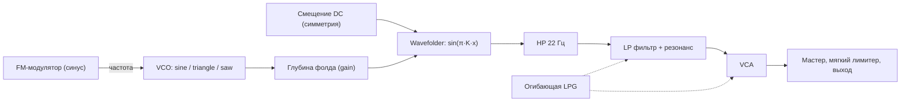

# Subversum: описание решения

Мобильный веб-синтезатор: одна страница `index.html`, которую можно установить как приложение (PWA). Кнопки нет: весь экран это поверхность. Любое нажатие вытягивает новый случайный патч и запускает арпеджиатор, который играет, пока палец на экране; движение пальца гнёт звук вживую (XY). Быстрый тап ловит один удар. Внешний вид и характер звука задаёт «мир» (скин): их восемь в ротации, свайп переключает. Звук целиком синтезируется в браузере через Web Audio API, зависимостей нет.

Этот документ описывает, как устроен голос, откуда берутся случайные значения, как работает генератор мелодий и интерфейс, и почему пресеты почти всегда звучат пригодно.

## 1. Идея

Модульный синтезатор в духе Buchla сводится к трём блокам: осциллятор, фолдер волны и low pass gate. Здесь они собраны в один голос (янтарный мир; у остальных миров свои голоса, см. «Звук скинов»). Пользователь ничего не настраивает, он нажимает, держит и ведёт пальцем. Каждое нажатие это новый патч.

Единственное жёсткое правило: октава всегда 1 или 2 (в научной нотации, C1 = 32.7 Гц, B2 = 123.5 Гц). Всё остальное случайно, но только внутри диапазонов, где звук остаётся годным (раздел 4).

## 2. Сигнальная цепь



Голос создаётся заново на каждую ноту и удаляется после затухания. Он монофонический: новая нота за 5 мс гасит предыдущую (отдельный `kill`-gain) и стартует на 12 мс позже, чтобы не было щелчков.

### 2.1. VCO и FM

- Несущая: `OscillatorNode`, форма случайно из sine, triangle, sawtooth.
- Модулятор: синусный `OscillatorNode` на частоте `f · ratio`, через `GainNode` подключён к `osc.frequency`.
- Девиация в герцах равна `index · f · ratio`, поэтому индекс модуляции (`i`) не зависит от высоты ноты: спектр всегда имеет порядка `i + 1` боковых полос с шагом в частоту модулятора.
- Индекс спадает во время ноты: `setTargetAtTime` к значению `index · fmSweep` с постоянной времени `0.7 · tau`.

### 2.2. Wavefolder

Сделан через `WaveShaperNode` с кривой на 4097 точек, `oversample = '4x'`:

```
y = sin(π · K · x),   K = 5,   x ∈ [-1, 1]
```

Входной сигнал `x = depth · osc + sym`, где `depth` задаётся `GainNode` перед шейпером, а `sym` это постоянное смещение (`ConstantSourceNode`), подмешанное прямо на вход шейпера.

- Пик аргумента синуса равен `π·K·depth`: от 0.94 рад при `depth = 0.06` до 12.6 рад при `depth = 0.8`.
- Фолдинг начинается там, где пик достигает π/2, то есть при `depth ≥ 1/(2K) = 0.1`.
- Число перегибов за полупериод примерно `K · depth`, до 4 при максимуме.
- Смещение `sym` до ±0.08 сдвигает фазу фолдинга на ±1.26 рад, что даёт асимметрию и чётные гармоники.
- Выход синусной кривой ограничен ±1 при любой глубине, поэтому громкость почти не зависит от глубины фолда, меняется только спектр.
- Глубина фолда спадает по ходу ноты к `depth · sweep` с постоянной `0.9 · tau`, так что звук начинает ярким и к концу «разглаживается».

После фолдера стоит фильтр высоких частот на 22 Гц (Q = 0.7). Он убирает постоянную составляющую от смещения, иначе при открытии VCA была бы слышна ступенька.

### 2.3. Low pass gate

Один сигнал управляет и громкостью, и срезом, как у вактрола:

| Параметр | Как работает |
|---|---|
| `tau` | `decay / 3`, то есть за `decay` секунд уровень падает примерно до 5 % |
| Атака | линейный подъём VCA от 0 до пика за 1–14 мс |
| Пик VCA | `0.9 · (1 − 0.45 · res / 18) · vel` |
| Срез | экспоненциальный подъём с 70 Гц до `cutoff` за время атаки, затем затухание к 70 Гц с постоянной `0.55 · tau` |
| Конец | `attack + 8·tau`, потом осцилляторы останавливаются, узлы отключаются |

Срез закрывается быстрее, чем падает громкость: хвост ноты становится глуше, как у настоящего LPG.

Фильтр это `BiquadFilterNode` типа lowpass. В Web Audio его `Q` для lowpass задаётся в децибелах, 0 дБ соответствует линейному Q = 1, 18 дБ примерно Q = 8. Пик громкости снижается вместе с резонансом (с 0.9 до 0.495), потому что резонанс добавляет уровень.

### 2.4. LFO за кадром

Половина патчей вообще без LFO, у остальных одно скрытое LFO, изредка два. LFO мягкие: они двигают звук, но не должны его портить. На экране они не показываются, только слегка ведут фон.

| Параметр LFO | Диапазон |
|---|---|
| Количество | 0 (50 % патчей), иначе 1, второе с вероятностью 20 % |
| Скорость | 0.02 – 3 Гц, логарифмически равномерно: от одного цикла за 50 секунд до плавного покачивания, без тремоло |
| Форма | sine (в три раза чаще) или triangle, без резких saw и square |
| Глубина | 0.15 – 0.6 от максимума цели |
| Начальная фаза | случайная |

Цель выбирается случайно из семи, глубина умножается на максимальный размах:

| Цель | Что модулируется | Размах при глубине 1 |
|---|---|---|
| `pitch` | `detune` несущей и модулятора вместе, так что FM-отношение не меняется | ±14 центов |
| `ratio` | `detune` только модулятора, отношение уезжает | ±120 центов |
| `index` | усиление FM-модулятора | ±0.25 · 4.5 индекса |
| `fold` | глубина фолда | ±0.18 |
| `sym` | смещение на входе фолдера | ±0.8 · 0.08 |
| `cut` | `detune` фильтра | ±1100 центов, около октавы |
| `res` | резонанс | ±3 дБ |

Как это сделано:

- Форма LFO это `PeriodicWave` из 32 гармоник. Начальная фаза задаётся поворотом гармоник (`k·φ`), потому что у `OscillatorNode` нет прямого параметра фазы.
- LFO принадлежит патчу, а не отдельной ноте. Тап создаёт новые LFO и останавливает LFO предыдущего патча. Все ноты зажатой мелодии пользуются одними и теми же LFO, поэтому медленные действительно «плывут» по ходу мелодии, а быстрые дают вибрато и тремоло по ходу ноты.
- Для каждой ноты создаются свои усилители, которые масштабируют LFO в единицы цели и подключают их к параметрам голоса. После ноты они отключаются, чтобы не накапливались узлы.
- У одиночного тапа очень медленное LFO выглядит как случайный статичный сдвиг параметра: за время одной ноты оно почти не движется.

### 2.5. Выход

`master` (0.85) → мягкий лимитер → `destination`.

Лимитер это ещё один `WaveShaperNode`. До 0.8 он линейный, выше скругляет: `sign(x) · (0.8 + 0.2 · tanh((|x| − 0.8) / 0.2))`. Он прозрачен для обычного уровня и ловит только случайные пики, например при перекрытии двух нот в момент передачи.

## 3. Случайные параметры

Функция `roll()` возвращает целый патч. Все значения независимы.

| Параметр | Диапазон | Распределение |
|---|---|---|
| Октава | 1 или 2 | 50/50, единственное жёсткое правило |
| Нота | 12 полутонов | равномерно, MIDI = 12·(oct+1) + semi |
| Форма волны | sine, triangle, sawtooth | равномерно |
| FM ratio | 0.5, 1, 1.5, 2, 2.5, 3, 3.5, 4, 5, 7 | из набора, в 25 % случаев с расстройкой ±2 % |
| FM index | 0 – 4.5 | равномерно |
| FM sweep | 0.05 – 1 | во сколько раз индекс упадёт к концу ноты |
| Глубина фолда | 0.06 – 0.8 | равномерно |
| Симметрия | ±0.08 | равномерно |
| Фолд sweep | 0.2 – 1 | во сколько раз глубина упадёт к концу ноты |
| Затухание | 0.12 – 1.8 с | логарифмически равномерно |
| Атака | 1 – 14 мс | равномерно |
| Срез | 0.9 – 9 кГц | логарифмически равномерно |
| Резонанс | 0 – 18 дБ | равномерно |
| LFO | 0 – 2 штуки (у половины патчей нет), скорость 0.02 – 3 Гц | см. раздел 2.4 |

Логарифмическое распределение там, где важно относительное изменение: на длинном затухании и срезе равномерное распределение почти всегда давало бы длинные и яркие звуки.

## 4. Почему пресеты почти всегда звучат пригодно

Это не чистая случайность, а случайность внутри заранее выбранных рамок:

- LPG связывает громкость и яркость, поэтому любая нота получает естественную форму: щипок, пинг или короткий бас. Беззвучных или статичных вариантов нет.
- Синусный фолдер нормирует уровень, а компенсация резонанса и лимитер держат громкость.
- FM-отношения берутся из набора простых и полупростых отношений, а не из непрерывного диапазона. Это почти всегда консонанс, а небольшая расстройка иногда даёт биения.
- Две низкие октавы дают плотный бас, который прощает почти любую настройку.
- Диапазоны подобраны на слух: нижняя граница глубины и среза не даёт совсем глухих звуков, верхняя граница индекса и резонанса не даёт совсем «шума».

## 5. Генератор мелодий

Запускается сразу при нажатии и играет, пока палец на экране. Если отпустить быстро, успевает прозвучать только первая нота: это всегда настоящая нота (не пауза), и она громкая.

При старте выбираются:

- Темп: целое от 110 до 135 BPM. Шаг это шестнадцатая, длительностью `60 / BPM / 4`, то есть от 0.111 до 0.136 с. Такт из 16 шагов длится от 1.8 до 2.2 с.
- Тоника: случайный из 12 полутонов.
- Лад: из семи благозвучных: MAJOR, MINOR, DORIAN, LYDIAN, MIXOLYDIAN, MIN PENTA, MAJ PENTA. Фригийский, гармонический минор, хирадзёси, целотонный и блюзовый убраны (2026-11-06). У миров свои подмножества (например, мандала только минорные, ризо MAJOR/MINOR/DORIAN/MIXOLYDIAN).

Пул нот: все ноты лада в диапазоне MIDI 24–47, то есть C1…B2. Поэтому правило об октавах 1 и 2 действует и в мелодии.

Генерация шага (`makeStep`):

- 22 % шагов это пауза.
- В 15 % случаев высота выбирается случайно из всего пула, иначе она сдвигается от предыдущей на ступень из набора −3, −2, −1, −1, 0, 1, 1, 2, 3. Это даёт мелодию, которая в основном идёт плавно, но иногда прыгает.
- Громкость шага: 25 % акценты с `vel = 1`, остальные от 0.62 до 0.85.

Пока нажатие удерживается, ничего не перебрасывается, включая LFO. Каждое нажатие бросает новый патч, лад, тональность, темп и рисунок из 16 шагов (`tapPatch`), и мелодия играет ими по кругу. Меняется только высота и громкость шага, затухание и тембр берутся из патча.

### 5.1. Планировщик

Таймер `setInterval` с периодом 25 мс смотрит на `ctx.currentTime` и ставит в расписание все шаги, которые попадают в окно 120 мс вперёд. Сами ноты планируются средствами Web Audio (`setValueAtTime`, `setTargetAtTime`), поэтому тайминг не зависит от того, насколько точно срабатывает таймер JavaScript.

Обновление экрана привязано к моменту начала ноты (`atTime`), а не к моменту планирования, чтобы картинка не опережала звук.

Когда нажатие отпускается, ноты, которые уже стоят в расписании, но ещё не начались, отменяются: гейт обнуляется, осцилляторы останавливаются, а их вспышки на экране не показываются. Благодаря этому быстрый тап даёт ровно один удар, каким бы коротким ни был шаг.

## 6. Интерфейс

Один экран без надписей, чисел и графиков. Кнопки и кольца секвенсера в мирах из ротации нет: экран целиком поверхность под палец (в коде круглая кнопка `#go` осталась только у светлых миров paper и donut, вне ротации).

- **Нажатие** вытягивает новый патч и запускает арпеджиатор, пока палец на экране. Быстрый тап ловит один удар.
- **Палец как XY-пад.** Пока держишь, палец гнёт звук: оси связаны с пятью общими макросами `cut`, `res`, `echo`, `space`, `color`, а каждый мир превращает их в свои ручки (таблицы в разделах «Палец как XY-пад» и «Экран отвечает на оси» ниже). Значения относительны: патч сохраняет характер. Положение пальца доступно как `window.subversum.xy` и событие `subversum:xy`.
- **Z** (время удержания) есть во всех восьми мирах: у каждого свой способ потратить его на звук и картинку (раздел «Z как время удержания» ниже).
- **Служебная полоса внизу** не играет; свайп вверх из неё открывает веер (замок, BPM и тональность, ссылка), подробнее в разделе «Сид, замок и веер» ниже. Когда замок включён, экран обведён рамкой, а свайп мира заблокирован.
- **Свайп** (быстрый флик больше 56 пикселей по горизонтали за 300 мс) переключает мир по кругу, музыка при этом не обрывается: темп, тональность и лад переходят в новый мир.
- **Миры в ротации** (случайный при запуске, `?skin=` принудительно): amber (ночная трасса), riso, scope, topo (рельеф), matrix, mandala, ridges (хребты), clouds. Светлые paper и donut остались в коде, открываются только по `?skin=paper|donut`.
- **Цвет и оттенок** меняются при каждом нажатии (раздел «Синестезия»): палитру красит `--hue`, яркость, насыщенность и темп движения считаются из характера патча.
- Нота, лад, темп и значения параметров не показываются, подсказок на экране нет: понять, что играет, можно только по звуку и по реакции картинки.

Тёмная тема единственная осознанно: страница моделирует прибор.

## 7. Ввод и совместимость

- Нота запускается на `pointerdown`, а не на `click`, чтобы не терять 100–300 мс на мобильных браузерах.
- Слушатели стоят на `body`, поэтому нажатие работает по всему экрану. `setPointerCapture` гарантирует, что отпускание будет доставлено, даже если палец сдвинулся.
- Дополнительно слушаются `pointerup`, `pointercancel`, `lostpointercapture` и `blur`, чтобы мелодия не залипала.
- iOS разблокирует звук только внутри `click` и `touchend`, поэтому на `click` добавлен повторный `resume()` с отложенным запуском первой ноты.
- `navigator.audioSession.type = 'playback'` там, где поддерживается, чтобы звук не глушился переключателем беззвучного режима.
- Пробел и Enter работают как кнопка (нажатие и удержание).
- `ConstantSourceNode` проверяется на наличие, на старых браузерах симметрия просто отключается.

## 8. Ограничения

- Динамик телефона почти не воспроизводит 30–60 Гц. Основной тон низких нот слышен слабо, а звук держится на гармониках от фолдера и FM. В наушниках бас заметно полнее.
- Сид живёт только в памяти страницы (замок) и в ссылке: списка сохранённых патчей нет, после перезапуска замок снят.
- Голос монофонический (в мирах с аккордами, ризо и мандале, играют несколько тонов, но это один «удар»). Новая нота обрывает предыдущую.
- Мелодия не мутирует и не меняет тембр, пока палец зажат (намеренно). Меняют звук только оси XY и время удержания (Z).
- Подсказок на экране нет вовсе, даже в веере (только значки) и едва заметная черта у нижнего края: жесты (держи, веди, свайпни, как снять замок) нигде не объяснены.
- Звук миров сначала проверялся только автоматически в хромиуме; на слух и на телефоне автор слушал часть (отзывы по clouds и ризо ниже). Известная проблема: хрип clouds на краях осей, причина не установлена (подозрение на нагрузку на процессор).
- Нет записи звука, вибрации и Wake Lock. Пороги жестов и высота нижней полосы на телефоне не подбирались.

## 9. Идеи для развития

- Список сохранённых патчей между запусками (замок и ссылка уже есть, см. «Сид, замок и веер»).
- Запись выхода в WAV (в веер не входит).
- Подобрать на слух глубину Z в шести новых мирах (amber, mandala, riso, scope, matrix, ridges): цифры первые, на телефоне их ещё не слушали.
- Второй голос (бас или дрон) в мирах со свободным местом; гармоники для маленького динамика телефона.
- Новые миры: лаборатория `lab/worlds.html` генерирует их из сида.
- Заморозка вторым пальцем (в Z-эксперименте не сделана).

## 10. Файлы и публикация

| Файл | Содержимое |
|---|---|
| `index.html` | вся страница: разметка, стили, скрипт |
| `manifest.webmanifest` | манифест PWA: имя, цвета, иконки, режим standalone |
| `sw.js` | service worker: кэш оболочки и работа без сети |
| `icons/` | иконки 192 и 512 пикселей, maskable 512 и `apple-touch-icon` 180 |
| `lab/worlds.html` | лаборатория миров: один полноэкранный фрагментный шейдер (WebGL), мир это сид (поле, искажение, режим отрисовки, палитра, постобработка); контракт со звуком: палец, удар, оттенок. `?sheet` показывает контактный лист, `?debug` подписи. В приложение пока не подключена |
| `README.md` | краткое описание |
| `DESIGN.md` | этот документ |

Страница статическая, подойдёт любой хостинг. В `index.html` подключён сниппет Vercel Web Analytics: на Vercel он заработает после включения Analytics в проекте, на других хостингах его скрипт отдаёт 404 и на работу страницы не влияет. Других внешних ресурсов страница не использует, шрифты не подключаются.

## 11. PWA

Страницу можно установить на домашний экран и открывать как приложение, в том числе без сети.

- **Манифест:** `display: standalone`, портретная ориентация, чёрные фон и цвет темы. Все пути относительные (`./`), поэтому приложение работает в подпапке, как на GitHub Pages (`/subversum/`).
- **Иконки:** остались от версии с кнопкой (кольцо из 60 делений, часть подсвечена янтарным, как у закрывающегося гейта, и кнопка со значком включения); с нынешним интерфейсом без кнопки они не совпадают, при желании их стоит перерисовать. Maskable-версия уменьшена, чтобы весь рисунок помещался в безопасный круг (80 % ширины), который остаётся после обрезки на Android.
- **Service worker:** при установке кэширует оболочку (страница, манифест, иконки). Навигация идёт сначала в сеть и обновляет кэш, без сети отдаётся кэшированная страница. Остальные запросы к тому же адресу идут из кэша. Запросы к `/_vercel/` (аналитика) не кэшируются, запросы к другим доменам не перехватываются.
- **Обновления:** новая версия страницы подхватывается при следующем открытии с сетью. Если меняются иконки или манифест, нужно поднять номер в `CACHE` в `sw.js`, чтобы старый кэш был удалён.
- **Установка:** в Chrome и Edge через меню или предложение установить, на iPhone через Safari: «Поделиться» → «На экран Домой». Для установки нужен HTTPS, GitHub Pages его даёт.
- **Звук:** как и в браузере, на iPhone звук включается только после первого касания экрана.

Для фона у каждого патча есть тихий двойник LFO: он ничего не слышно меняет и ведёт только свечение, когда у патча нет звукового LFO.

## Скины

При каждом запуске случайно выбирается один из восьми тёмных внешних видов (amber, riso, scope, topo, matrix, mandala, ridges, clouds) (`html[data-skin]`, выбор делает маленький скрипт в `<head>` до первой отрисовки). Звук, арпеджиатор и логика у всех одинаковые, меняется только оформление. Для проверки можно принудительно задать вид адресом `?skin=amber|riso|scope|topo|matrix|mandala|ridges|clouds`. Светлые скины paper и donut убраны из ротации по решению автора (слишком светлые), их код остаётся в файле и открывается по `?skin=paper` или `?skin=donut`, но свайпом до них не добраться. При желании их можно перекрасить в тёмные.

**Переключение свайпом.** Стартовый скин выбирается случайно (случайный индекс в списке из восьми), дальше его можно менять горизонтальным свайпом: влево следующий, вправо предыдущий, по кругу. Свайпом считается смещение больше 56 пикселей, заметно горизонтальное (в 1.5 раза больше вертикального). В момент свайпа арпеджиатор останавливается (если успел стартовать, прозвучит максимум одна нота), старый слой стирается, строится новый, текущий рисунок шагов и цвет переносятся. Обычный тап скин не меняет. Анимация двухфазная: пока палец тянется, сцена едет за ним и тускнеет, внизу появляются точки-индикатор (текущий вид это вытянутая светлая точка); при пересечении порога старая сцена уезжает в сторону свайпа за 0.17 с, затем новая влетает с противоположной стороны за 0.32 с, точки остаются на секунду. Повторный свайп во время смены игнорируется.

Страница обрезает выступающие за экран свечения (`overflow: hidden` на `html, body`), иначе мобильный браузер расширял layout viewport (453×981 вместо 390×844), и фиксированные слои сдвигались.

**Сквозное правило: цвет и оттенок меняются при каждом нажатии у всех скинов.** Патч задаёт переменную `--hue` (sine холодный около 192°, triangle около 38°, saw около 6°, индекс FM добавляет до 36°). Каждый скин строит свою палитру из `--hue` со своим смещением, поэтому при значении по умолчанию (38) выглядит так, как задумано, а после нажатия палитра уезжает. Пока палец держится, цвет не меняется.

- **amber**: чёрный и янтарный, основной вид. Акцент это `hsl(--hue …)`.
- **riso**: тёмная бумага, ризографические чернила. Розовый круг (оттенок `--hue + 302`) смешивается через `screen` с полутоновым кругом партнёрского оттенка (+140°) со сдвигом, как при неточной приводке. Кнопка цвета бумаги, шаги залиты основным чернилом, играющий шаг тёмный. Сверху зерно.
- **scope**: осциллограф, сетка, сканлайны, виньетка. Фосфор от зелёного к бирюзовому и синему (`--hue · 0.5 + 100`). Ринг это трасса, форма которой считается из патча (отношение FM, индекс FM, глубина фолда).
- **topo**: рельеф. Топографические контуры на тёмном тоне оттенка (`--hue + 38`), кнопка-вершина, шаги это 16 дуг на одной из горизонталей. Контуры медленно вращаются в разные стороны.
- **matrix**: матрица точек. Размер точек расходится волной от кнопки, оттенок `--hue − 23`, кнопка кремовая, шаги это кольцо крупных точек.
- **paper**: слои цветной бумаги с тенями, оттенки раскладываются вокруг `--hue − 34`. Шаги это 16 выступов волнистого слоя: чем громче нота, тем больше выступ.
- **donut**: хрустящий глазированный донат. Рваный край теста (`feDisplacementMap`), глазурь оттенка `--hue + 302`, посыпка это шаги, в дырке кнопка.

Скины riso, scope и amber переопределяют цвета и слои CSS-селекторами `html[data-skin=…]`. Скины topo, matrix, mandala, ridges, paper и donut рисуют собственную картинку в полноэкранном SVG-слое `#skin` (координаты с центром в середине экрана, `viewBox="-195 -422 390 844"`) и подключаются через хуки: `pattern(sq)` (рисунок шагов), `note(i, vel)` (вспышка), `frame(t, env, kick, head)` (покадровая анимация), `idle()` (сброс в покой).

### Анимация скинов

Покадровый цикл `fxFrame` работает, только пока что-то движется (играет арп, идёт огибающая или не затух «удар»), потом останавливается сам. Каждая нота даёт удар `kick`, который затухает за ~0.2 с.

- **scope**: трасса пересчитывается каждый кадр. Она плывёт во времени, дышит с огибающей, толстеет и светится на ударе, а по кольцу с темпом секвенсора бежит горб (положение берётся из часов арпеджиатора, поэтому он идёт и по паузам). Фоном ходит яркая полоса развёртки и слегка мерцает экран.
- **riso**: вокруг розового круга 16 чернильных точек (розовые и синие по очереди, размер от громкости, паузы бледные). Играющая точка вспыхивает цветом бумаги и подпрыгивает. На каждой ноте синий полутоновый круг дёргается в случайную сторону, как сбитая приводка, и пружинит назад. Розовый круг дышит с огибающей, размер полутоновых точек растёт с громкостью, зерно мерцает.

- **topo**: сами кривые живые. Каждое кольцо пересчитывается каждый кадр из медленно плывущих фаз, поэтому вся карта течёт. В покое кадры идут примерно 24 в секунду, при игре на полной частоте. Музыка ускоряет течение (время растёт быстрее с огибающей и ударом) и раздувает рельеф (амплитуда до +50% от огибающей и +60% от удара). 16 дуг шагов едут по одному из колец и повторяют его форму. Играющая дуга вспыхивает контрастным цветом и утолщается. Поверх контуры медленно вращаются в разные стороны. При смене скина цикл останавливается (`SK.dispose`), при `prefers-reduced-motion` рисуется один кадр.
- **matrix**: волна точек бежит наружу от кнопки, её сила растёт с огибающей и ударом. Играющая точка кольца вспыхивает и подпрыгивает.
- **paper**: слои бумаги расходятся с разной амплитудой, играющий выступ подпрыгивает цветом бумаги.
- **donut**: играющая посыпка вспыхивает белым и подпрыгивает, глазурь чуть вздувается на ударе, сахарные искры мерцают.

### Мандала (mandala)
16 лепестков, по одному на шаг. Длина и ширина зависят от громкости ноты, паузы это маленькие бутоны. На ноте лепесток вспыхивает и на 150 мс «выстреливает». Между ними 16 малых лепестков, которые медленно вращаются в обратную сторону, и пунктирные кольца. Кик слегка раздувает все слои. Цвет берётся из `--hue`.

**Звук мандалы: дэб-техно аккорды.** Голос мандалы (остальные миры тоже со своими голосами, см. «Звук скинов»). Образец: мир Portus в репо touch2decay (стабы Basic Channel).
- **Лад:** только минорные: minor, dorian, phrygian, harmonic minor, minor pentatonic.
- **Аккорд:** одна огласовка на нажатие, интервалы от основы как в Portus: m7 `[0,7,10,15]`, m9 `[0,7,10,14,15]` (оба вдвое чаще), m11 `[0,7,10,14,15,17]`, sus `[0,5,10,14]`. Основа чаще всего тоника (65%), иногда скользит на другую ступень лада. Основы лежат в одной октаве (1 или 2), аккорд строится вверх от них.
- **Голос:** на каждый тон пара пил с расстройкой ±5–8 центов, два фильтра 24 дБ подряд, щипок: срез раскрывается на `cut*2^(env*4.2*vel)` и падает к `cut`, длина щипка `tau = 0.035 + len²·1.8`. Лёгкая случайная панорама на каждый удар. 45% пауз.
- **Рандом на нажатие:** тип аккорда и лад, срез, глубина щипка, резонанс (0–15 дБ), длина, медленный дрейф среза, время эха (1/8, 3/16, 1/4, 3/8, 1/2), фидбэк, количество эха (иногда 0), тон эха, ping-pong по каналам, длина реверберации (1,2–4,5 с) и её количество.
- **LFO:** всегда один медленный на срез фильтра (0,04–0,4 Гц, 0–900 центов). Плюс в 60% нажатий один или два дополнительных (0,03–0,5 Гц, синус или треугольник) на резонанс, фидбэк эха, количество эха, количество реверба или wow времени эха. Защита от перегруза: глубина каждого ограничена долей базового значения (ничего не уходит в минус), фидбэк не поднимается выше 0,86, в петле эха стоит мягкий tanh-насытитель, резонанс уменьшает уровень аккорда, на выходе общий мягкий лимитер.
- Хвосты звучат после отпускания, старая шина гасится через ~3 с после следующего нажатия. Тап ловит один аккорд.

### Хребты (ridges)
Кислотная раскраска: один горизонтальный градиент красит все линии, у каждого из 16 шагов своя точка с собственным оттенком (оттенки идут по кругу с шагом 1,5 круга), весь круг медленно дрейфует по оттенку (быстрее при громкой игре), точка сыгранного шага на мгновение вспыхивает почти белым и гаснет за ~0,5 с. Точки шагов внизу красятся теми же цветами. Паузы тусклые.
Стопка из 36 линий рельефа с перекрытием (как обложка Unknown Pleasures). Каждая нота пускает горб от x-позиции своего шага вверх по стопке, горб расширяется и затухает. Фоновая рябь растёт с огибающей. Внизу ряд из 16 точек-шагов. Свой rAF-цикл (в покое ~24 fps), останавливается через `SK.dispose`.


## Звук скинов (не янтарь)
У каждого скина, кроме янтаря (базовый FM + фолдер + LPG), свой голос и своя шина эха и реверба со своими диапазонами случайности (общий ping-pong, реверб из шумового импульса, LFO на шине, мягкий насытитель в петле эха). Октавы нот остаются 1–2, паттерн, лад и тембр не меняются, пока держишь, тап ловит один удар.
- **Мандала:** дэб-техно аккорды (см. выше).
- **Ризо:** банк резонаторов (полосовые фильтры с высокой добротностью, три гармоники на тон), настроенных на мажорный или минорный аккорд (трезвучие или септаккорд по ступени лада: MAJOR, MINOR, DORIAN, MIXOLYDIAN), возбуждается всплеском шума. Добротность растёт с частотой, поэтому низкие тона звенят дольше. После резонаторов лёгкое огрубление по битности.
- **Осциллограф:** лазеры по ударным Horologium из ветки native репо touch2decay (`core/worlds/horologium/drums.cpp`). Три режима на нажатие: ZAP (синус или пила падает с нескольких кГц на ноту через tanh), STUTTER (3–8 коротких FM-гранов, питч растёт, промежутки сжимаются ×0,7), BIT (1-битный шум выше 6 кГц). Акценты и часть ударов добавляют «пинг» (всплеск шума в узкий резонатор 1,5–6 кГц). Перед выходом фильтр высоких (140–1000 Гц), чтобы низкие ноты не звучали глухо, короткий ping-pong эхо.
- **Рельеф:** не секвенция, а эволюционирующий дрон, пока держишь. Две пульсовые волны (пила через ступенчатый waveshaper и постоянное смещение, смещение качает свой медленный LFO, так получается PWM) с расстройкой и квинта, два фильтра 24 дБ с резонансом (до 14 дБ), срез дрейфует двумя несинхронными LFO (0,03–0,12 и 0,1–0,35 Гц). Большой реверб. Шаги на экране идут, но звука не издают. Тап даёт короткий взмах.
- **Матрица:** чиптюновые блипы с четырьмя субшагами (арпеджио октав и квинт внутри шага), огрубление по битности, ступенчатый полосовой фильтр.
- **Хребты:** ацид в духе TB-303. Один осциллятор (пила или квадрат на нажатие), перегруз, два фильтра подряд с резонансом до 20 дБ, огибающая среза с распадом (случайная глубина и время), акценты (громче, глубже и короче огибающая), слайды между связанными нотами (гейт не закрывается, питч едет за 60 мс), прыжки на октаву, лады minor/phrygian/harmonic minor/minor pentatonic/blues/dorian, 28% пауз. Эхо с мягким ревербом.
Проверено автоматически в хромиуме (ошибок нет, сигнал и затухание есть), на слух и на телефоне не проверялось.

## Эволюционирующие скины без секвенсера
Рельеф играет непрерывный дрон, шаги не звучат и не светятся. Картинку ведёт модуляция звука: огибающая яркости следует двум LFO среза (0,5 + 0,28·LFO_A + 0,22·LFO_B), по кругу из 16 дуг бежит яркое пятно с фазой быстрого LFO, раз в цикл быстрого LFO вспышка (kick и свечение кнопки). Реализовано хуком `cont.mod()` голоса и таймером 33 мс (`startMod`). Туннель «приближение» с восходящим шепардом удалён по решению автора («не могу найти концепцию»).

## Синестезия: палитра и темп читают звук
Каждое нажатие после создания патча и паттерна считает три числа (`characterOf`, 0…1), и по ним красится весь экран (`setAccent`, `applyMood`):
- **Яркость звука** (срез фильтра внутри диапазона голоса этого скина и глубина огибающей) → светлота экрана: CSS-фильтр `brightness(0,8…1,18)` на `html`.
- **Живость** (резонанс, глубина огибающей, доля играющих шагов, темп, короткие ноты) → насыщенность (`saturate(0,6…1,25)`) и темп движения: переменная `--act` (0,6…1,6) и множитель `ACT` в покадровой анимации рельефа и хребтов, длительность вращения мандалы `calc(90s / var(--act))`.
- **Холод** (яркость, пространство эха и реверба, резонанс, FM) → оттенок `--hue` от тёплого янтаря 28° через розовый и фиолетовый до холодного синего (218°). Остальные цвета скинов строятся от `--hue` со своими смещениями, как раньше.
Яркость считается внутри диапазона голоса скина, поэтому у каждого скина встречаются и тёплые, и холодные, тёмные и светлые, спокойные и активные нажатия.

## Без кнопки и XY
Кнопка и кольцо секвенсера остаются в янтаре, мандале и ризо («пока»). В осциллографе, рельефе, матрице и хребтах их нет (`display: none`), экран целиком это поверхность. Геометрия экранов прежняя, но волны и эффекты идут не из центра, а от пальца: координаты пальца в единицах слоя скина лежат в `FP` (`vx, vy`, центр экрана это 0, 0). Осциллограф: поле «Жизни» Конвея (26×56 клеток на торе), каждая нота пускает в точке пальца глайдер (громкая) или блинкер (тихая) и сдвигает поколение, в тишине поле медленно дрейфует, вымершее пересеивается, переполненное прореживается; возраст клетки задаёт размер и яркость. Рельеф: контуры (36 колец, от маленького ядра в центре, дыры в середине нет) мягко расталкиваются от пальца, от него на каждый бит LFO и при касании уходит круг-рябь. Матрица: кольца яркости `cos(d/24 − t·2.4)` идут от пальца, поверх них две медленные интерференционные волны, поэтому переливается всё поле и тёмных зон нет (собственный rAF, как у рельефа). Хребты: каждая нота пускает бугор из точки пальца вверх и вниз по стопке, ряд точек шагов убран. Хребты расширены до ±330 по x.
**Задел под xy-pad:** состояние `window.subversum.xy = { x, y (0…1, y вниз), nx, ny (-1…1 от центра, ny вверх), down }`, событие `subversum:xy` (detail = то же) и хук скина `SK.xy(xy)`. Звук к координатам пока не привязан.
**Свайп** теперь только быстрый флик: больше 56 пикселей по горизонтали за первые 300 мс. Более медленное движение двигает мир (xy).

## Без кнопки везде (2026-11-06)
Кнопки и кольца секвенсера нет ни в одном скине. Круг под палец не двигаем: «явный и чёткий круг» не смещаем.
**Янтарь: ночная трасса** (`buildAmber`). Неоновая сетка-дорога уходит к полосатому солнцу за силуэтом города, цвет от `--hue` (янтарный по умолчанию). Дорога едет всегда, скорость растёт с огибающей и кик; каждая нота пускает по дороге яркую поперечную планку; пока палец держится, точка схода тянется к пальцу (дорога изгибается), высота горизонта слегка следует по y.
**Ризо:** плоские цветные круги разного размера (заливка и контур, `mix-blend-mode: screen`, зерно остаётся) дрейфуют по экрану; нота даёт в точке пальца кремовую вспышку круга, ближайший круг подпрыгивает, кик раздувает все.
**Мандала:** цветок вернулся, но без кнопки и кольца шагов и без привязки к секвенсеру: пять слоёв лепестков (12, 16, 20, 24, 28), чем глубже, тем крупнее и медленнее вращается, растут на весь экран. «Расцветает»: слои раскрываются по очереди из середины, пока играет, и наполовину закрываются в тишине. Параллакс: слои смещаются от пальца с разной глубиной. Положение пальца играет радиальный градиент-свечение, которое плавно идёт за ним и растёт с огибающей.

## Палец как XY-пад: у каждого скина свои два параметра (2026-11-06)
Каждое нажатие по-прежнему вытягивает новый патч, а палец гнёт его вживую, пока держишь: значения относительны (множители и смещения от того, что выпало), поэтому характер патча сохраняется. Нажатие стартует там, где палец; медленное движение двигает параметры, быстрый флик по горизонтали меняет скин.
| скин | X (слева направо) | Y (снизу вверх) |
|---|---|---|
| янтарь | яркость (срез, ±1,4 октавы) | гармоники (индекс FM и глубина фолда) |
| мандала | эхо: количество и фидбэк | срез фильтра (±1,6 октавы) и резонанс (дабовая пара) |
| ризо | яркость аккорда | длина звона резонаторов и реверб |
| осциллограф | высота лазера (свип, зёрна) | эхо: количество и фидбэк |
| рельеф | срез дрона (живьём) | размах ШИМ (ширина импульса дрона, живьём) и реверб |
| матрица | глубина кранча (биты) | фокус фильтра (резонанс) |
| хребты | срез (ацид) | резонанс (ацид, живьём) |
Реализация: `applyXY(nx, ny)`; в шине эха хранятся базовые значения (`bus.base`) и глубины модуляторов, поэтому при смене эха и фидбэка их собственные LFO пересчитываются, и фидбэк вместе с покачиванием не превышает 0,86. Для амбера глобальные множители `XM`, которые читает `play()`. Для проверок: `window.subversum.sound()` возвращает текущие значения шины.

### Экран отвечает на оси (2026-11-06, перечень утверждён)
Тот же палец двигает и картинку, и звук. Сглаженное положение пальца `XV` (x, y от 0 до 1, y вверх) читают все скины.
| скин | X | Y |
|---|---|---|
| янтарь | свечение неона и дороги | размах полос на солнце |
| мандала | сколько колец-эха идёт за нотой | яркость лепестков и скорость вращения |
| ризо | насыщенность печати кругов | как долго звенит вспышка круга |
| осциллограф | цвет клеток (от холодного к горячему) | сколько копий глайдера идёт за нотой (эхо) |
| рельеф | чёткость линий (тоньше и ярче вправо) | рельеф набухает и опадает вместе с ШИМ, рябь бежит дальше и чаще |
| матрица | грубость картинки (число уровней яркости от 2 до 5) | резкость колец и яркость |
| хребты | яркость линий | высота и острота горбов |
Мандала стала живее: у каждого лепестка своя качка и дыхание, слои вращаются со скоростью музыки, нота запускает волну набухания от центра наружу.

## Переход между мирами: параметры связаны, модуляции переходят (2026-11-06)
Оси XY управляют не ручками одного мира, а пятью общими макросами: `cut` (срез), `res` (резонанс), `echo`, `space` (реверб, у ризо ещё длина звона), `color` (гармоники: FM и фолд в янтаре, ШИМ в рельефе, кранч в матрице, высота лазера в осциллографе). Каждый мир сам превращает макросы в свой звук (`applyMacros`). Оси миров: янтарь x cut, y color; мандала x echo, y cut и res; ризо x cut, y space; осциллограф x color, y echo; рельеф x cut, y color и space; матрица x color, y res; хребты x cut, y res.
Свайп с зажатым пальцем больше не обрывает музыку. Старый мир затихает на своей шине эха и реверба (шина гаснет за доли секунды, хвост идёт сам), новый берёт тот же темп, тональность и, если есть такой лад, тот же лад, начинает играть сразу с тем же пальцем, а макросы остаются и за 1,5 секунды плавно перетекают к осям нового мира. Например, эхо, открытое в мандале, продолжает звучать в осциллографе, пока ты не сдвинешь палец. Новое нажатие (не свайп) начинает с нуля от положения пальца. После свайпа точка отсчёта флика сдвигается на палец, так что можно листать миры серией быстрых флипов.

## Восьмой мир: clouds, «кольца в облако» (2026-11-06)
Идея пользователя: что-то вроде Rings into Clouds / beads, то есть с гранулами. Придумано заново, без заимствований из репо.
**Звук:** калимба: язычок с сильным основным тоном (удвоен с лёгкой расстройкой, медленные биения), двумя быстро гаснущими обертонами балки (около ×6,3 и ×17,5) и щелчком большого пальца, на две октавы выше пула нот. Тот же рендер пишется в четырёхсекундную память (кольцевой буфер, старое затухает ×0,6). Пока идут ноты и ещё две секунды после последней, из памяти непрерывно режутся зёрна: 16–80 в секунду, длиной 40–220 мс, с плавно дрейфующей позицией чтения (70 % из свежей ноты, остальное из старых), питч ×1 / ×2 / ×0,5 / ×1,5 с лёгкой расстройкой, окно Ханна, случайная панорама, низкочастотный фильтр от среза. Ранняя версия сыпала по 3–13 зёрен на ноту и звучала как треск. Лады: мажор, минор, дорийский, мажорная и минорная пентатоника. Большой реверб.
**Экран (россыпь):** каждая нота оставляет под пальцем облачко точек (память, гаснет за те же 4 секунды) и яркую вспышку удара. Каждое зерно звука зажигает несколько точек ровно на свою длину с тем же окном Ханна: вбок по панораме зерна, вверх и вниз случайно, быстрые зёрна (×2) ярче. Ось X: от немногих крупных мягких зёрен к мелкому плотному туману, ось Y: насколько далеко от пальца разлетаются зёрна. Фоном редкие тусклые точки. Рисуется 12 SVG-путями из точек по размеру и яркости, зерна приходят в экран через хук `SK.grain` из `cloudRun`.
**Оси:** X: зёрна от немногих крупных «бусин» к плотному мелкому «туману» (на экране размер и число бусин). Y: реверб и яркость (на экране как далеко и как долго уходит облако). Макросы: x это `color`, y это `space` и `cut`.

### clouds: wet на верху оси Y и shimmer
Характер мира: гранулярное облако плюс shimmer (октава вверх). Хвост реверба проходит через сдвиг на октаву вверх (две линии задержки со скоростью изменения времени 1 с/с, перекрёстные окна Ханна, период 60 мс) и возвращается в реверб, поэтому каждый проход поднимается на октаву и тает в тёмном фильтре (6,5 кГц). Ось Y у верха уходит в полностью мокрый звук: от 30 % оси вверх сухой сигнал плавно падает до ~8 %, посыл в реверб растёт (до 1,4), уровень shimmer и его обратной связи растут (0,18→0,68 и 0,18→0,38). Верх оси: почти только облако и shimmer, низ: сухой колокольчик калимбы. Рост обратной связи проверен на 9 секундах удержания, пик 0,43.

### Лады и параллакс рельефа (2026-11-06)
- Остались только благозвучные лады: мажор, минор, дорийский, лидийский, миксолидийский, мажорная и минорная пентатоника. Убраны фригийский, гармонический минор, хирадзёси, целотонный, блюзовый. У миров свои подмножества: мандала (минор, дорийский, минорная пентатоника), хребты (минор, дорийский, минорная пентатоника), ризо (мажор, минор, дорийский, миксолидийский), clouds (мажор, минор, дорийский, пентатоники).
- Рельеф: три слоя контуров (дальний, средний, ближний) смещаются против пальца с глубиной 0,06 / 0,13 / 0,24 от положения пальца, плавно (k≈4/с). Без касания слои медленно покачиваются сами. Вдавливание контуров считается в собственной системе слоя, поэтому остаётся под пальцем.

### clouds: половинный темп
Clouds играет в два раза медленнее остальных миров: 55–68 BPM вместо 110–135 (шестнадцатая длится вдвое дольше). Темп при свайпе с зажатым пальцем пересчитывается: в clouds делится на два, из clouds умножается на два, так что общий пульс сохраняется.

### clouds: хрип на краях осей (отзыв с телефона 2026-11-06)
На телефоне при максимуме X и максимуме Y мир хрипел. В хромиуме клиппинга и роста биений по огибающей нет, поэтому подозрения: нагрузка на процессор (до 80 зёрен в секунду по 3 узла, плюс реверб и shimmer, при максимумах всё сразу) и резкость на верху (срез 12 кГц, shimmer до 6,5 кГц, реверб до 1,4). Сделано: зёрен не больше 52 в секунду, минимальная длина зерна 100 мс вместо 60 (меньше узлов, плавнее перекрытие), пять общих панорамных узлов вместо панорамера на каждое зерно, кэш кривых окна, срез clouds не выше 7,5 кГц (диапазон патча 2,5–7 кГц), фильтр на выходе зёрен до 9 кГц, shimmer через фильтр 4,5 кГц и тише (выход до 0,54, обратная связь до 0,32), посыл в реверб не выше 1,2. Если хрип останется, нужно знать, на каком краю и когда (при движении или в покое).

### Z как время удержания (2026-11-06 clouds и рельеф, 2026-11-08 все миры)
Z = как долго держишь палец: секунда ничего, затем плавно раскрывается за ~11 секунд (smoothstep 0..1), сбрасывается при отпускании и при новом нажатии. Без подсказок, без датчиков давления, на любом устройстве. Теперь во всех восьми мирах (`ZH` в коде, `window.subversum.z()`). Звук Z считает `applyMacros`, он вызывается из `zTimer` каждые 100 мс, картинка читает `ZH` в цикле отрисовки мира. Z это медленная добавка поверх X и Y, а не отдельный регистр: ничего не заменяет и всегда уходит при отпускании.
- **Clouds:** звук: доля зёрен из свежей ноты падает с 70 до 30 % (зёрна берутся из старой памяти), растёт доля зёрен на октаву вверх и вниз (до 35 % особых питчей), shimmer громче (+0,2 выход, +0,1 обратная связь). Экран: зёрна разлетаются шире (+70 % по горизонтали, +50 % по вертикали).
- **Рельеф:** звук: унисон пил расходится до 4,5-кратной расстройки, квинта громче (×2,2), дыхание фильтра глубже (+80 %). Экран: рельеф набухает (+45 %), дрейф быстрее, параллакс слоёв глубже (×2).
- **Янтарь** (`ring · longer`): звук: затвор звенит дольше (×1,9 к затуханию), индекс FM +35 %, фильтр открывается на 0,4 октавы. Экран: солнце растёт на 10 %, полосы на нём качаются сильнее, дорога бежит быстрее (+60 %), поперечные линии ярче (+40 %).
- **Мандала** (`feedback · deeper`): звук: эхо громче (+0,12) и обратная связь глубже (+0,14), повторы копятся. Экран: цветок раскрывается шире (внешние слои сильнее), свечение шире (+110), слои крутятся быстрее (+80 %).
- **Ризо** (`ring · longer`): звук: аккорд звенит дольше (+0,2 к длине), комната открывается (+0,15 реверба). Экран: диски растут на 16 %, дрейф быстрее (+70 %), вспышки живут дольше (+80 %).
- **Scope** (`echo · deeper`): звук: эхо громче (+0,14) и обратная связь глубже (+0,17). Экран: живые клетки толще, а после середины раскрытия за нотой идёт ещё одна копия планёра.
- **Матрица** (`arp · busier`): звук: арпеджио уходит к более подвижному пулу (+0,7 по оси arp), фильтр острее (+2 к резонансу). Экран: точки ярче (+50 %), волны бегут быстрее (+60 %).
- **Ridges** (`squeal · higher`): звук: срез открывается на 0,6 октавы, резонанс растёт на 3 (до потолка 20). Экран: хребты выше (+6) и дрейфуют быстрее (+60 %).
Вторым пальцем (заморозка) пока не делали.

### Ризо: попытка «хрустальных капель» отклонена (2026-11-06)
Пробовали color bass: тело (саб и пилы с падением высоты) бьёт по банку резонаторов на нотах аккорда со стрэмом. Пользователь на слух: «вообще не похоже», вернули прежний звук ризо (банк резонаторов, возбуждаемый шумом, с огрублением). Если вернёмся к идее, нужен референс или описание тембра, а не угадывание.

### clouds: направление зёрен по секвенсору (2026-11-06)
Шестнадцать шагов теперь управляют не нотами одними: на каждое нажатие (сид) вместе с рисунком нот выпадает рисунок направления зёрен, вперёд или назад, на все 16 шагов (паузы тоже). Типы рисунков: все вперёд (12 %), последние 3–5 шагов такта назад, половина такта назад, равномерно разбросанные шаги (эвклидов рисунок из 3–7), чередующиеся группы по 2–4 шага. Зерно на шаге назад читает ту же память в обратном порядке (отдельный перевёрнутый буфер, так как источник в Web Audio не умеет отрицательную скорость) и имеет «обратное» окно: медленно нарастает и обрывается коротко (последняя десятая быстро затухает, чтобы не щёлкать). На экране такие зёрна собираются внутрь и опускаются, а не расцветают и не поднимаются. Рисунок не меняется, пока держишь, как и всё остальное; `window.subversum.rev()` показывает его для отладки.


## Сид, замок и веер (решения и реализация 2026-11-08)

Статус: реализовано целиком, проверено автоматически в headless Chrome (см. «Как реализовано»); на телефоне пока не проверялось: пороги жестов, системные жесты у нижнего края, окно «Поделиться», вид рамки на слабых устройствах.

### Зачем
Публика просила видеть BPM, автор хотел остаться в понравившемся патче. Цель: зафиксировать сид, прочитать темп и тональность (для задания темпа в сэмплере) и переслать патч ссылкой, не добавляя на экран ни кнопок, ни надписей.

### Что отвергнуто
- **Автокулдаун** (несколько секунд после касания тапы играют тот же сид). Быстрый повторный тап после неудачного патча должен давать новый патч, иначе кажется, что приложение зависло. Вместо него явный замок.
- **Угол с веером** и **разные скорости свайпа** (быстрый и долгий): нужно гадать пороги. Жест один.
- **Запись звука** в WAV в веер не входит.

### Служебная полоса и жест
- Внизу экрана полоса, которая не играет: касание в ней не бросает патч, не запускает арпеджиатор и не двигает оси XY. Высота полосы 96 пикселей плюс нижний безопасный отступ, подбирается на телефоне: самый край занят системными жестами (домой на iPhone в PWA, жестовая навигация на Android), свайп нужно начинать чуть выше него. Едва заметная черта у нижнего края (прозрачность около 16 %) подсказывает, что там что-то есть; это добавлено сверх обсуждённого и убирается одной строкой (`#handle`).
- Единственный жест: **свайп вверх из полосы открывает веер**. Веер всегда в одном месте (по центру), замок всегда в его центре, чтобы работала мышечная память. Выбор: палец ведётся к пункту, отпускание на пункте выбирает, отпускание мимо отменяет. Всё за доли секунды, без задержки открытия.
- Веер можно вызывать вторым пальцем, пока первый играет: музыка не прерывается (требует разделения пальцев по `pointerId`: сейчас второй палец заново бросает патч, а его отпускание останавливает мелодию).

### Содержимое веера
Решение автора (2026-11-08): веер это непрозрачный полукруг на нижнем краю экрана высотой в нижнюю шестую часть, нарезанный секторами; в секторах значки без подписей. Экран за ним затемняется полупрозрачно и равномерно. BPM и строй крупным текстом сверху по центру. Справки в веере нет.
- **Сверху по центру, крупно:** BPM (например 118) и под ним тональность с ладом (например «A min penta»), для сэмплера; только показ. В clouds показывается реальный темп сетки (55–68, при переносе возможны дробные значения вроде 61,5). До первого нажатия вместо числа прочерк.
- **Секторы** (слева направо): hold (значок касания: пунктирное кольцо, кольцо и точка, при включении точка закрашена), замок (открытый или закрытый значок, переключатель, в центре) и «поделиться» (стрелка вверх из лотка; системное окно «Поделиться» со ссылкой, без поддержки копирование в буфер, пока делиться нечем сектор тускнеет). Секторов поровну, добавить пункт значит добавить ещё один сектор.
- **Выбор:** сектор целиком является зоной нажатия, а не только значок. Под пальцем сектор заливается цветом мира (`--hue`), замок включённый подсвечен всегда. Узкая мёртвая полоса на стыках секторов (около 5 % ширины сектора) ничего не выбирает. Отпускание на секторе выбирает, мимо (за краем полукруга) или отмена ничего не делают. Выбрать можно только после того, как палец ушёл от точки касания на 36 пикселей, чтобы короткий взмах не задел замок.

### Hold: палец «всегда держит» (2026-11-08)
Сектор hold в веере включает режим, в котором играет так, будто палец не отпускается.
- **Включение.** Если ничего не играет, включение запускает виртуальное нажатие в последней позиции (бросается новый сид, при замке прежний). Если музыка уже идёт (например, веер поднят пальцем, который играет), она просто продолжается. Отпускание настоящего пальца музыку не останавливает.
- **Касание в hold** не бросает патч: оно только переносит позицию (оси идут за пальцем, как всегда), после отпускания позиция остаётся. Быстрый боковой взмах в hold это просто позиция: свайп мира и попытка снять замок в hold отключены.
- **Выключение** тоже сектором hold. Если настоящего пальца на экране нет, музыка останавливается; если палец лежит, играет, пока его не поднимут.
- **Резкий уход пальца в полосу.** Играющий палец, который за 140 мс прошёл вниз больше 70 пикселей со скоростью больше 0,7 пикселя в миллисекунду и оказался в нижней полосе, поднимает веер под тем же пальцем: оси замирают на последней позиции до полосы, сектор выбирается отпусканием. Если увести палец из веера обратно вверх, веер закрывается и палец снова играет. Отпустил не на секторе: обычное отпускание, музыка останавливается (если hold не включён). Медленный спуск в полосу это обычное движение по оси Y, веер не появляется. Пороги подбираются на телефоне.
- **Проверено автоматически** (12 проверок): веер поднимается резким уходом и не поднимается медленным спуском; оси замирают, пока веер поднят; после отпускания на hold музыка идёт и палец не нужен; касание в hold двигает позицию без нового сида; взмах не меняет мир; выключение веером останавливает музыку; включение из тишины запускает музыку; возврат пальца вверх закрывает веер. Не проверялось: вместе со вторым пальцем (P-ось) в hold, и на телефоне.

### Замок
- Держит **сид и мир**: нажатие играет тот же сид, свайп мира заблокирован. Положение пальца (XY) и время удержания (Z) остаются свободными.
- Состояние видно **рамкой**: статичный слой поверх всего (без реакции на касания), виньетка (затемнение к краям) и тонкая линия цвета мира (`--hue`). Смена состояния меняет только прозрачность, без дорогих фильтров (`backdrop-filter` поверх живых миров не используем). Боке допустимо только готовыми градиентами.
- **Попытка свайпа при замке** (только новым касанием, не движением пальца при игре, чтобы взмахи по оси X в XY не принимались за свайп): экран трясётся (при «уменьшении движения» вместо тряски короткая вспышка рамки), рамка на секунду ярче (окно видно, считать не нужно). **Повтор в ту же сторону** новым касанием в этом окне снимает замок и выполняет свайп. Свайп в другую сторону это новая попытка. Перенос музыки с зажатым пальцем при замке не нужен; без замка поведение прежнее.

### Сид
Один 32-битный сид задаёт всё, что определяет «патч»: тип голоса и параметры, лад, тональность, темп, рисунок из 16 шагов (ноты, громкость, паузы, направление зёрен), «свободные кубики» голосов миров. Не задаёт: положение пальца на осях, время удержания, микрослучайность внутри мира (зёрна, панорама, шумовые буферы, фазы LFO, импульсы реверба). Поэтому ссылка даёт «тот же патч, но свои руки», а не тот же звук. Генератор псевдослучайных чисел мульберри32, запись сида в base36.

### Ссылка
`?skin=<мир>&seed=<сид>&v=<версия>`. Версия сида нужна, потому что любое изменение диапазонов параметров или добавление мира меняет смысл сида: старые ссылки после этого должны либо играть по прежним правилам, либо честно сообщать о несовпадении. Открытая ссылка: первое касание играет присланный сид, следующие бросают новые, как обычно. На iPhone ссылка откроется в браузере, а не в установленном PWA.

### Как реализовано
- **Сид.** `withSeed(seed, fn)` на время `fn` подменяет `Math.random` генератором mulberry32, поэтому весь бросок (`roll()` и `makeSeq()`: патч, лад, тональность, темп, 16 шагов, голос мира, эхо и реверб) становится функцией сида, а в остальное время работает настоящая случайность. Сид 32-битный, записывается в base36 (до 7 знаков). `window.subversum.seed()` отдаёт текущий, `window.subversum.patch()` снимок патча для проверок. Проверка: во всех восьми мирах один сид даёт один и тот же патч, разные сиды разные, без сида патчи разные (поле `lfoT0`, время старта LFO по часам аудио, в патч не входит).
- **Один палец играет.** Играет первое касание (`activeId`). Второе не бросает патч, не двигает оси и не останавливает мелодию; касание в полосе обрабатывается отдельно (`stripId`).
- **Веер.** Свайп из полосы (вверх, можно наискось, больше 16 пикселей) открывает веер сразу. Вверху по центру BPM и строй, внизу полукруг из секторов (SVG, `viewBox 0 0 200 100`, полукруг растёт от нижнего края и по высоте равен шестой части экрана). Попадание считается по углу и расстоянию до центра полукруга (до радиуса плюс 18 пикселей). Веер можно вызвать вторым пальцем при игре.
- **Замок.** Держит сид (нажатие играет `curSeed`) и мир (свайп блокируется). Состояние видно по рамке `#lockframe`: виньетка и тонкая линия цвета `--hue`, меняется только прозрачность. Можно включить и до первого нажатия: тогда первый брошенный сид останется.
- **Попытка свайпа при замке.** Работает по прежнему порогу (больше 56 пикселей по горизонтали за 300 мс от начала касания, то есть только новым касанием) и только раз за касание: экран трясётся (`lockshake`, 380 мс; при «уменьшении движения» тряски нет), рамка ярче на секунду. Повтор в ту же сторону новым касанием в эту секунду снимает замок и выполняет свайп с переносом музыки, как раньше. Другое направление начинает новую попытку.
- **Ссылка.** Пункт «ссылка» открывает системное окно (`navigator.share`) с адресом `…?skin=<мир>&seed=<сид>&v=1`; без `navigator.share` ссылка копируется в буфер. Если открыть такую ссылку, первое касание играет присланный сид, следующие бросают новые. Ссылка с другой версией (`v`) сид игнорирует. Версия `SEED_VERSION` поднимается при любом изменении диапазонов или порядка бросков.
- **Ограничения.** Патч после свайпа с зажатым пальцем зависит и от перенесённых темпа, тональности и лада, а не только от сида: такой патч помечается как «не чистый», и пункт «ссылка» в веере тускнеет до следующего нажатия. Замок и сид не сохраняются между запусками. Ссылка, открытая на iPhone, откроется в браузере, не в установленном PWA.
- **Проверено автоматически:** воспроизводимость сида во всех мирах, изоляция второго пальца, веер и выбор пунктов (в том числе вторым пальцем при игре), замок (тот же сид, свайп заблокирован, тряска и рамка, снятие повтором в ту же сторону, противоположное направление не снимает), ссылка (параметры, первое касание играет сид, версия). Не проверено: звук на слух, телефон.

## P-ось: второй палец (2026-11-08), пока только в clouds
Идея пользователя: второй палец это отдельная ось P, и у каждого мира свои два действия: **второй тап** и **пинч**. Общего смысла нет, миры получают P по одному.
**Ввод (общий для всех миров).** Играет по-прежнему один палец. Второй палец, севший вне нижней полосы (полоса и веер остаются за ними) и не во время свайпа мира, включает `PX.on` и держит его, пока лежит. `PX.d` это пинч, от −1 до 1: логарифм расстояния между пальцами относительно расстояния в момент касания вторым пальцем (1: вдвое дальше, −1: вдвое ближе), мёртвая зона ±0,08. Подсказок на экране нет. Отпустить первый палец или свайпнуть мир значит отпустить и P. Миры без действий P второй палец игнорируют. Отладка: `window.subversum.p()`.
**clouds.** Тап: память гранул замораживается. Пока палец лежит, новые ноты звенят, но в память не пишутся, облако не затухает (`cl.until` держится), после отпускания тает за 1,5 с. Пинч: разброс высоты зёрен. Вместе зёрна сходятся в унисон (при −1 только ×1), врозь разлетаются на три октавы (от ×0,25 до ×4, до 75 % зёрен при +1).
**Остальное по плану, пока не сделано:** янтарь (тап: удар с открытым LPG; пинч: затухание LPG), ризограф (удар по резонатору; демпфирование), осциллограф (лазерный зап; глубина падения высоты), рельеф (всплеск пульса; расстройка второго голоса дрона), матрица (ратчет; скорость арпеджио), мандала (аккорд с броском в эхо; время задержки), хребты (акцент со слайдом; глубина огибающей).
Проверка в Chromium (двумя касаниями через CDP): память пишется 18 раз за 2,5 с без P и 0 раз с лежащим вторым пальцем; доля унисонных зёрен 62 % без P, 100 % при пинче вместе, 8 % при пинче врозь; в amber и ridges P ничего не меняет, ошибок нет. Слышно это или нет, не проверено, нужен телефон.

### P-ось: второй палец рисуется анимацией самого мира (2026-11-08)
Общее кольцо убрано: оно не принадлежало миру. Второй палец теперь получает ту же анимацию, что и первый, в стиле мира: `FP2` (как `FP`, в координатах слоя скина) задаёт вторую точку, и мир рисует там то же, что у первого пальца. Первая реализация в clouds: на каждую ноту облако бусин и вспышка удара возникают у обоих пальцев, а пока второй палец лежит, половина зёрен звука расцветает вокруг него (в остальное время всё как было). Каждый новый мир с P делает то же в своём `SK.note` и остальных точках, где он читает `FP`, и добавляется в `P_WORLDS`.
**Открытый вопрос.** В clouds действия P (заморозка памяти, разброс высоты зёрен) почти не читаются на слух: мир и так абстрактный. Для пробы смысла P лучше брать мир с ясным звуком (хребты, матрица, мандала).

### P-ось в хребтах (эйсид, 2026-11-08)
**Тап:** акцентный стаб на октаву выше последней ноты, с подъёмом (слайдом) к ней и широко распахнутым фильтром (пик на 1,5 октавы выше обычного акцента); паттерн играет дальше под ним. Это одноразовый удар в момент касания. **Пинч:** глубина и длина огибающей фильтра каждой ноты, множитель 2^(1,3·d) на глубину и 2^(0,7·d) на затухание: врозь глубже и длиннее «уау», вместе плоско и коротко. **Экран:** второй палец, пока лежит, шлёт свои горбы по стопке на каждую ноту, а тап отправляет большой (1,6). Первый палец как был.
Проверка в Chromium: пик фильтра на нотах в среднем 2,0 кГц без P, 5,1 кГц при пинче врозь, ниже 1,5 кГц при пинче вместе; тап планирует стаб; ошибок нет. Слышно ли это приятно, нужно проверить на телефоне.

## Янтарь: жесты переосмыслены (2026-11-08)
Решение с пользователем: переосмысливаем жесты миров по одному, начали с янтаря. Заодно решено, что **пинч P постоянный**: он остаётся после того, как второй палец поднят, продолжается с того же места при следующем пинче и сбрасывается новым нажатием, новым патчем или свайпом мира; **тап временный** (удар, или у clouds заморозка, пока палец лежит). В DESIGN выше «P пинч в clouds и хребтах возвращается к нулю при отпускании» больше не так: он тоже остаётся.
**X: как открывается LPG** (новый макрос `lpg`): влево короткий щипок, вправо длинный звон. Затухание ноты ×2^(1,5·x), от ×0,35 до ×2,8. Срез больше не на X.
**Y: путь через тембры.** Внизу голый носитель (индекс FM и фолд около нуля), в середине патч нажатия как есть, выше растёт FM (до ×1,5), потом фолдер кусается (до ×2,5); яркость следует за Y (срез ×2^(0,8·y)). FM и фолд больше не растут вместе: FM первым, фолд позже.
**P тап:** последняя нота ещё раз, сильнее (1,2), с атакой 2 мс, срезом ×3, FM ×1,4 и затуханием ×1,3. Она занимает место звучащей ноты, паттерн идёт дальше. **P пинч:** отношение модулятора FM: вместе оно подтягивается к целому (чистый тон), врозь уходит от целого вверх до ×2^0,55 (негармоничный колокол), 0 это отношение патча.
**Экран.** Пока второй палец лежит, точка схода дороги уходит к середине между пальцами, планки тяжелее, тап отправляет по дороге толстую планку; полосы дороги расширяются или сужаются вместе с пинчем (×1±0,35) и остаются такими, пока пинч не сброшен, так что значение видно.
Проверка в Chromium: XM по углам (низ слева: срез 0,69, FM 0,34, фолд 0,05, затухание 0,39; верх справа: срез 1,53, FM 1,38, фолд 2,14, затухание 2,54), центр 1/1/1/1; тап добавляет голос; пинч остаётся после поднятия второго пальца и обнуляется новым нажатием; clouds и хребты ведут себя как раньше, но с постоянным пинчем; ошибок нет. На слух и на телефоне не проверено.

## HUD: отладочная панель жестов (2026-11-08)
Идея пользователя: писать изменения характеристик на экран, можно в игровом стиле. Только для отладки, для игроков по умолчанию выключена (принцип «без подсказок» остаётся).
**Включение:** `?hud=1` в ссылке, или `window.subversum.hud(true)` (запоминается в `localStorage`, выключить `?hud=0` или `hud(false)`). Кнопки в веере нет. Панель сверху слева, поверх мира, касаний не ловит.
**Что показывает.** Шапка: имя мира, значки HOLD, LOCK, P (второй палец лежит) и BPM. Три строки X, Y, P: имя оси в этом мире (`HUD_LABELS`: янтарь GATE / TIMBRE / FM RATIO, clouds DENSITY / SPACE / PITCH SPREAD, хребты CUTOFF / RESONANCE / ENV DEPTH, у остальных пока только X и Y), число −1…+1 и полоса из блоков от центра. Внизу сырые значения: у янтаря множители XM (затухание, срез, FM, фолд), у остальных срез в герцах, резонанс, эхо и реверб шины. Всплывают пиксельные подписи: изменение оси на 0,25 и больше («+0,41 GATE»), тап P («TAP ACCENT»), HOLD и LOCK on/off, смена мира. Новая ось нового мира добавляется в `HUD_LABELS`.

## Ризо: жесты переосмыслены (2026-11-08)
**X: чем бьём** (новый макрос `hit`). Шум-возбуждение резонаторов идёт через фильтр низких частот от 0,5 кГц (слева, глухой мягкий удар) до 6 кГц (справа, яркий щёлкающий). Срез на выходе больше не на X (остаётся срезом патча). **Y: сколько звенит** (новый макрос `ring`): длина звона `len` ±0,55, реверб растёт с Y как раньше (0,4), но это уже второстепенно.
**P тап:** последний аккорд бьётся ещё раз, сильнее (1,25), с распахнутым возбуждением (шум до 16 кГц, атака 0,5 мс, звон на 30 % дольше). Он идёт поверх паттерна. **P пинч (постоянный): огибающая удара.** Вместе короткий резкий щелчок (затухание от 8 мс к 2,8 мс), врозь удар набухает и держится, как будто по аккорду ведут смычком (атака до 90 мс, затухание до 120 мс; громкость возбуждения компенсируется под корень длины).
**Экран:** на каждую ноту (и тап) второй палец, пока лежит, зажигает свои пятна-диски; пинч виден по длине вспышек (врозь ×2,6, вместе ×0,55) и остаётся таким же, пока не сброшен.
**Общее.** `applyXY` теперь обнуляет макросы, которые оси мира не используют (раньше они могли остаться от прежнего мира при свайпе). HUD читаем на светлых и тёмных мирах: цвета HUD свои, от `--hue`, а не из `--ink`/`--accent` мира (в ризо они тёмные).
Проверка в Chromium: срез возбуждения слева около 0,6 кГц, справа до 16 кГц; длина звона 0,75 вверху и 0,03 внизу; затухание удара при пинче врозь 0,12 с, вместе 0,0028 с; тап и второй палец ошибок не дают, янтарь, clouds и хребты как раньше. На слух и на телефоне не проверено.

### HUD включён везде на время настройки (2026-11-08)
`HUD_DEFAULT = true`: пока настраиваем жесты, панель видна во всех мирах без параметра. Выключить: `?hud=0` или `window.subversum.hud(false)` (запоминается). Вернуть «только по ссылке»: поставить `HUD_DEFAULT = false`.

## Мандала: жесты переосмыслены (2026-11-08)
**X: эхо-бросок.** Количество эха ±0,55 (было 0,45) и фидбэк ±0,3 (было 0,25); при движении вправо сухой аккорд ещё и тонет (сухой сигнал до −45 % при максимуме). Время эха X не трогает. **Y: фильтр.** Срез как был; резонанс больше не движется вместе со срезом, он подключается только у верха (от 35 % выше центра, до +7 к патчу, плавной ступенью, у верха самоосцилляция), поэтому макрос `res` в осях мандалы не используется.
**P тап: бросок (throw).** Последний аккорд бьётся ещё раз, эхо получает его в полную силу: количество эха +0,5, фидбэк +0,2, сухой аккорд на 350 мс уходит вниз (до −65 %); эффект плавно сходит за 1,3 с (`thrAmt`). **P пинч (постоянный): время эха.** Множитель 2^(1,5·d) к времени патча: вместе в 2,8 раза короче, врозь в 2,8 раза дольше (не меньше 30 мс, не больше 2,9 с). Время меняется со скольжением (константа 0,25 с), как у ленты, поэтому повторы изгибаются по высоте, пока двигаешь пальцы. Эхо теряет привязку к долям, пока пинч не сброшен.
**Экран.** Кольца эха идут и от второго пальца, пока он лежит. Расстояние между кольцами `0,24·2^(1,5·d)` с зависит от пинча и остаётся (значение видно). Тап пускает длинную серию из 6 колец от второго пальца.
Проверка в Chromium: срез/резонанс/эхо/фидбэк по углам (слева-внизу эхо 0,07, справа-внизу 0,95, у верха резонанс 16); время эха при пинче врозь около 1,0 с, вместе около 0,13 с; тап добавляет удар и проседание сухого; ошибок нет. Нужно проверить на слух и на телефоне, особенно, не слишком ли тонет сухой звук справа и не перегружается ли эхо на броске.

## Осциллограф: жесты переосмыслены (2026-11-08)
X (высота лазера) и Y (эхо) остались как были. Новое только на P.
**P пинч (постоянный): вид удара.** Патч, как и раньше, выпадает случайно в один из трёх видов: зап (синус или пила падает с нескольких кГц на ноту), статтер (очередь коротких FM-зёрен) или бит (1-битный шум). Пинч едет по ним: `u = clamp(базовый вид + 2,2·d, 0, 2)` (зап 0, статтер 1, бит 2). Вместе каждый удар чистый зап, врозь крайний бит, посередине (d=0) родной вид патча. Между видами каждый удар выбирает одного из двух соседей случайно по дробной части `u`, поэтому переход это смесь, а не переключатель. Рисунок паттерна, лад и темп те же, меняется характер каждого удара.
**P тап: выстрел.** Последний удар ещё раз, громко (1,3), только зап с самым глубоким падением (с 14 кГц, время падения 20 мс, затухание ×1,6) и с пингом в резонаторе. Идёт поверх паттерна.
**Экран.** Пока второй палец лежит, он тоже бросает фигуры в поле «Жизни» (на каждую ноту), а пинч виден по тому, что бросается: вместе одни глайдеры, в середине как раньше (глайдер громкой ноты, блинкер тихой), потом три блинкера в ряд (очередь), у края россыпь из 9 случайных клеток (шум). Тап бросает два глайдера от второго пальца.
Проверка в Chromium: пинч вместе даёт 23 осциллятора за 3 с, врозь ни одного (только шум); ошибок нет. На слух и на телефоне не проверено.

## Матрица: жесты переосмыслены (2026-11-08)
**X: кранч** без изменений. **Y: диапазон арпеджио** (новый макрос `arp`, резонанс больше на Y не сидит, он остаётся в патче). Набор отношений прыжка по Y: до −0,6 один тон (чистый блип), до −0,2 `[1,1,2]`, до 0,3 прежний набор `[1,2,1.5,3,4,0.5]`, до 0,7 `[2,3,4,1.5,0.5,6]`, выше `[3,4,6,8,0.5,0.25]`, а скачок, который ушёл бы выше 9 кГц, заменяется на ×1. Выше 0,3 полосовой фильтр прыгает вдвое чаще.
**P пинч (постоянный, ступенями, это бит-мир): число субшагов арпеджио в шаге.** Вместе (d < −0,33) 8, посередине 4 (как было), врозь (d > 0,33) 2. Затухание каждого субшага укорачивается при 8 (×4/n). **P тап: ратчет.** Последняя нота бьётся 4 раза подряд на одной высоте, громче (2×), поверх паттерна.
**Экран.** Кольца яркости идут и от второго пальца, пока он лежит. Пинч виден по их плотности: при 8 субшагах кольца вдвое чаще, при 2 вдвое шире, и это остаётся, пока пинч не сброшен. Тап пускает от второго пальца быстрое кольцо-волну (0,9 с).
Проверка в Chromium: Y внизу: 4 субшага с отношением 1; Y вверху: до ×8 и ×0,25; пинч вместе 8 субшагов на голос, врозь 2; ошибок нет. На слух и на телефоне не проверено.

## Рельеф: жесты переосмыслены (2026-11-08), P есть во всех мирах
X (срез дрона) и Y (ширина пульса и реверб) остались, они в этом звуке читаются. Решение с пользователем: нот в дроне нет, поэтому P даёт событие и интервал.
**P тап: вдох (swell).** Дрон за 0,25 с поднимается и за 2 с оседает: громкость ×1,5 (мгновенно, возврат за 0,7 с), срез ×2^1,3, расстройка и дыхание как при долгом удержании (+0,8 к Z). Огибающая `swellAmt` (рост за 0,25 с, затем экспонента 0,9 с, до 2,6 с). **P пинч (постоянный, ступенями): интервал второго голоса.** Вместо фиксированной квинты (×1,4983): октава (×2), кварта (×1,3348), квинта (по умолчанию), малая секста (×1,5874), тритон (×1,4142), малая секунда (×1,0595); пороги d: −0,6, −0,2, 0,2, 0,45, 0,75. Интервал подтягивается скольжением (константа 0,4 с). Вместе дрон пустой и чистый, врозь всё напряжённее, на малой секунде сильные биения.
**Экран.** Второй палец расталкивает контуры, как первый, и пускает рябь на каждый бит LFO, а тап пускает три волны одну за другой, и рельеф на время вдоха выше и сильнее. Интервал виден в мерцании среднего слоя контуров: чем больше напряжение (0 у октавы, 1 у малой секунды), тем сильнее оно «бьётся».
Проверка в Chromium: второй голос 147 Гц (октава), 110 (квинта), 78 (малая секунда) при основе 73,4 Гц; тап даёт всплеск громкости и среза; ошибок нет. На слух и на телефоне не проверено.
**Итог.** P-ось есть во всех восьми мирах: янтарь, ризо, осциллограф, рельеф, матрица, мандала, хребты, clouds. Чего нет: подсказок на экране (HUD включён только на время настройки).

## HUD модуляции (`#mod`)

Постоянный, не отладочный, но молчит, пока ничего не меняется. Это стек сообщений по центру сверху: строка появляется, когда меняется её ось, самая свежая яркая, предыдущие уходят вниз и медленно гаснут. Звуковой код не трогает: читает живое состояние раз в кадр (`XY.nx/ny`, `PX.d`, `PX.on`, `ZH`, `zT0`, `skin`, `holding`, `holdOn`, `locked`).

- **Строки.** Семь штук, созданы заранее: оси `x`, `y`, `p`, `z` (строка с баром) и события `world`, `hold`, `lock` (только текст). Каждая строка это название и слово направления, под ними бар.
- **Что подписано.** Таблица `MOD` в index.html: для каждого мира `x` и `y` это `[что, слово слева/снизу, слово справа/сверху]`, `p` это `[что, пальцы вместе, пальцы врозь]` плюс `pt` (что делает тап), `z` у всех миров: `[что, как движется]`. Слова взяты из реального кода (в матрице вправо означает чище, потому что растёт число бит; в ridges вверх означает резонанс). Меняя ось в `AXES` или P-действие мира, надо менять и эту таблицу. В рельефе подпись P живая: показывает выбранный интервал.
- **Когда строка просыпается.** X и Y только когда палец сдвинулся больше чем на 0.03 от значения, показанного в прошлый раз (дрожь покоящегося пальца не считается, а новое нажатие тихо «прилипает» к своей позиции и ничего не показывает). P: касание вторым пальцем (`tap · …`) и сдвиг пинча. Z: новое нажатие (countdown), начало раскрытия и полное раскрытие; между ними строка просто живёт. События: смена мира, hold, lock.
- **Стек.** `order` хранит строки от свежей к старой. Строка уходит наверх, только если проснулась после паузы больше 400 мс; две оси, которые двигаются вместе, не меняются местами. Яркость строки = затухание по времени (`MOD_HOLD` 0.8 с держит, `MOD_FADE` 3.2 с гасит) × множитель места в стеке (`MOD_RANK`: 1, 0.6, 0.38, 0.2); дальше четвёртого места строка скрыта. Сдвиг вниз это `transform` с CSS-переходом.
- **Бары.** X, Y, P двусторонние: заливка идёт от центральной риски, на конце «головка». Z односторонний: первая секунда (`Z_WAIT` в `zTimer`) это countdown с пунктиром, который сжимается, дальше заливка по `ZH` (то, что реально слышно).
- **Стиль мира.** Всё через токены `--k-*` на `#mod` под `html[data-skin=...]`: цвет и свечение, шрифт и регистр, толщина и маска бара, форма головки. Цвета берутся из `--hue` и производных (`--rh`, `--sh`, `--tp`, `--mh`), то есть следуют за оттенком, который меняется при каждом нажатии. Чтобы строки не терялись на ярких фонах, под каждой лёгкое тёмное пятно.
- Отладочный HUD (`#hud`, `?hud=1`) остался, выключен по умолчанию и сдвинут ниже `#mod`.

## Coral отклонён (2026-11-08)
Попытка девятого мира «растущая колония» (Z растит ветки, каждая ветка это новая нота паттерна) убрана в тот же день. Отзыв пользователя: мир неинтуитивен, бедный по графике и по звуку.
Что вынесено: (1) граф «шаг по горизонтали, высота по вертикали, ветка от родителя» не читается как музыка, пока не объяснён; (2) один голос (капля на пластине) и один эффектный тракт слишком бедны рядом с остальными мирами; (3) идея «Z меняет форму мелодии» остаётся живой, но её нужно привязать к понятному образу, а не изобретать новую метафору.
Дальше миры берём из паттернов модульного синтеза (случайность с памятью, евклидовы кольца, два осциллятора на векторскопе, циклические огибающие), и перед кодом каждый описывается подробно и рисуется статичным эскизом экрана.

## Вектор: описание мира (2026-11-08), реализован девятым миром
Первый мир из паттернов модульного синтеза (четырёхканальный VCA-микс, Veils, и векторный синтез, Prophet VS). Принятый в обсуждении вариант, реализован в index.html (`?skin=vector`). Экранные прототипы без звука: `lab/vector-flow.html` (поток частиц, принят) и `lab/vector-screen.html` (шейдер, отвергнут).

**Идея.** В четырёх углах экрана живут четыре разных звука. Все четыре играют одну и ту же ноту арпеджио, палец это микс между ними. Не фильтр и не эффект, а смена материала: туман, стекло, дерево, металл.
**Оси.** X «мягко → звонко», Y «долго → коротко»: туман вверху слева, стекло вверху справа, дерево внизу слева, металл внизу справа. Вес углов билинейный по положению пальца, равная мощность. Слой с весом ниже ~3 % не запускается, чтобы платить CPU только за слышимое. **Z:** через секунду точка микса начинает кружить вокруг пальца, радиус за 12 секунд растёт до 0,22 экрана. Мелодия та же, что у clouds (тот же генератор, пул из двух октав, те же лады, темп вдвое медленнее). Мутации паттерна нет: Тьюринг как движок тоже отвергнут (2026-11-08, второй день). **P пинч:** жёсткость победителя; вместе поля и звуки смешиваются мягко, врозь один материал подавляет остальные. **P тап:** микс на шаг прыгает в ближайший материал со вспышкой и всплеском частиц, потом возвращается.
**Экран.** Одна основа: 2400 частиц на canvas 2D, следы за счёт затухания. Узор определяется полем течения, углы задают поле: туман это завитки (curl-шум), стекло прямые отрезки с изломами на границах ячеек, дерево кольца вокруг нижнего левого угла, металл сетка с поворотами на 90°. Скорость частицы это взвешенная сумма четырёх полей, победитель усилен (степень 1 + 2,5·жёсткость). Стык материалов лежит в точке 1 − m, поэтому площадь материала равна его весу в звуке. Цвет базовый светлый, у каждого узора слабый оттенок. Палец слегка завихряет частицы. Всплеск от ноты у каждого материала свой: туман мягкое облако, стекло лучи по шести углам, дерево круг, металл четыре оси. Текста и процентов на экране нет. Адаптивность: число частиц само уменьшается при просадке кадра; счётчик по `#fps` или касанию тремя пальцами.
**Что отброшено при обсуждении.** Лиссажу (нет внятного звука, экран как контрольный прибор), Евклид (выпадает из концепта по визуалу, звуку и управлению; оставлен в запасе), Тьюринг как отдельный мир (упор на мелодию, снова прибор) и позже как скрытый движок мутации под Вектором (отвергнут при первой же реализации, мелодия берётся как у clouds). Шейдерная версия экрана (четыре текстуры по областям, `lab/vector-screen.html`) отвергнута: выглядела как коллаж четырёх картинок, а не одна основа.
**Урок.** Картинка должна быть телом звука, а не схемой алгоритма; механизм скрыт. Новый мир сначала обсуждается словами, и только потом рисуется.
**Открыто.** Звук четырёх материалов (тембры, нагрузка CPU на iPhone 13), подтверждение FPS экрана на телефоне.

**Как реализовано (2026-11-08).** Звук: голос `VOICES.vector` играет ноту через четыре слоя, у каждого своя октава (пул ноты два октавы C1..B2 как во всех мирах, множители ×2, ×4, ×8, ×16): туман пять сильно расстроенных пил (±17 и ±34 цента) через мягкий low-pass, дерево маримба (основной тон и два быстро затухающих обертона плюс щелчок), металл шесть прямоугольников хэта 808 на ноте плюс синус для высоты, стекло FM-колокол с отношением 3,5 и падающим индексом. Вес слоя это корень из веса области; слой ниже 3 % не создаётся. Уровни слоёв выровнены по анализатору (BAL: 1,4, 0,95, 0,85, 1,5). Темп как у clouds вдвое медленнее (шаг 1/8): иначе длинные хвосты тумана и стекла накладывались бы слишком густо. `hitVoice` научен давать источнику свой конец (`o._end`), чтобы короткие слои не крутили осцилляторы вхолостую, и освобождает узлы по самому долгому источнику. Оси: x `color`, y `ring` (макросы AXES), точка микса `vecMix` = палец + орбита Z (радиус 0,22·ZH, 0,9 рад/с) или снап P. P тап: микс на 220 мс прыгает в ближайший материал, последняя нота бьётся снова и из точки идёт всплеск частиц; P пинч: резкость границы (вместе 0, по умолчанию 0,3, врозь 1). Экран: поток частиц на canvas 2D с ограничителем плотности и автоснижением числа частиц при просадке кадра; HUD: `timbre`, `body`, `border`, `orbit`.
**Проверено в Chromium:** все девять миров без ошибок на удержании с движением; свайп clouds → vector → amber (оболочка canvas убирается, темп подстраивается 64 → 114 BPM); уровни по анализатору (пик 0,2 до 0,6, без клиппинга) в каждом из четырёх углов и в центре; Z доходит до 1, пинч и тап P работают. **Не проверено:** звук на слух, FPS и нагрузка CPU на iPhone 13 (замер нужен на телефоне).
